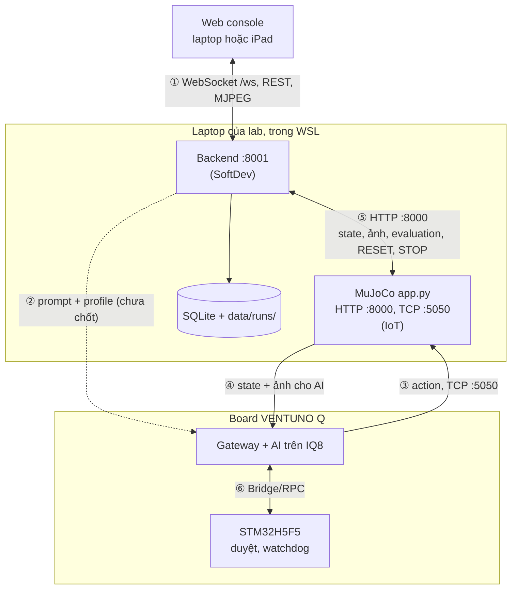
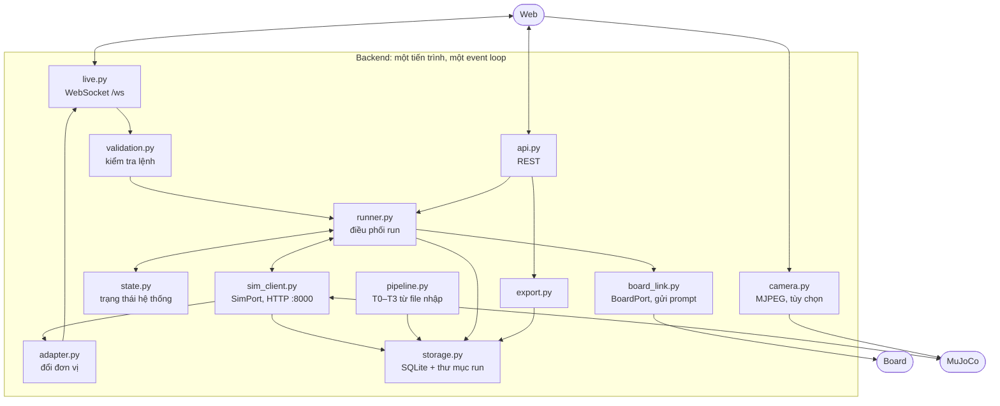
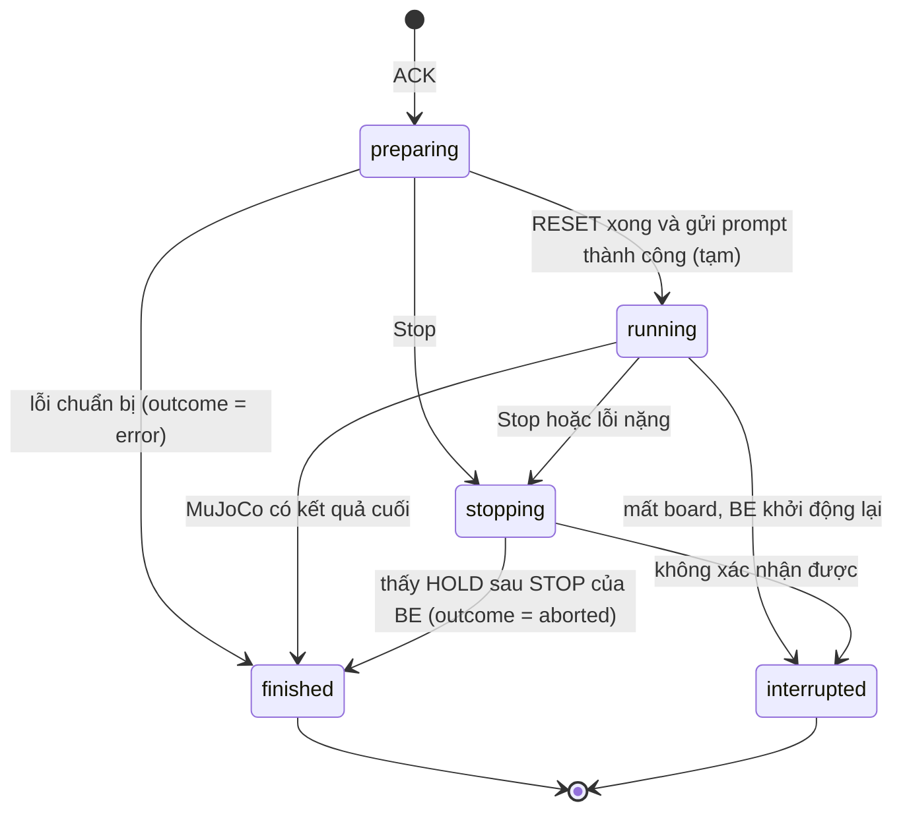

# SO-101 Backend Spec (Project A)

**Phiên bản:** v2.0, 17/11/2026 (thay v1.0 ngày 04/11/2026)
**Dành cho:** cả team (SoftDev code theo; IoT đọc mục 6, 7, 15; AI đọc mục 6, 15)
**Thay thế:** Spec v1. Đi cùng trang "SO-101 Backend" (bản 16/11): trang đó giải thích cho người đọc, tài liệu này là chi tiết để code. Hai bên phải khớp nhau; sửa bên nào thì sửa luôn bên kia.
**Nơi lưu đề xuất:** `docs/backend-spec.md` trong repo, để sửa theo commit (Plan §1.4).

---

## 0. Cách đọc

**Nhãn trạng thái**

| Nhãn | Nghĩa |
|---|---|
| **[CHỐT]** | Có căn cứ từ Plan, code FE, buổi họp nhóm hoặc trả lời của IoT. Code theo luôn. |
| **[ĐỀ XUẤT]** | Chọn để code được ngay. Chủ sở hữu có thể đổi, nên code phải gói gọn trong một file. |
| **[CẦN XÁC NHẬN]** | Chưa có nguồn. Xem mục 15: hỏi ai, và trong lúc chờ thì dùng giá trị nào. |

**Mã nguồn**

| Mã | Tài liệu |
|---|---|
| [P] | Team & Project Plan HN_1 (chốt 25/10) |
| [M] | Họp nhóm ngày 09/11 (SoftDev, IoT, AI): luồng dữ liệu mới |
| [I4] | Trả lời của IoT (Chung) ngày 09/11 về API của MuJoCo, RESET, STOP |
| [FE] | Repo `wykh4hn/robo-arm-app`, nhánh `claude/festive-dijkstra-ssd666`, commit `13a6ddd` |
| [iPad] | Nhánh `feature/ipad-adaptive-layout`, commit `a865096` (Triều, 11/11): bố cục iPad trong `MonitoringPage` |
| [I1] | SO101 Full Integration Report + Quick Run Guide (IoT, 28/10) |
| [I2] | STM32H5F5 Execution Path and USB Reference Baseline (IoT) |
| [I3] | Simulator Selection and Communication sample test (IoT) |
| [BR] | BE report and FE overview |
| [BP] | Blueprint Architecture v0.3 |
| [H] | Trang "SO-101 Backend", bản cập nhật 16/11 |
| [PT] | Bản chạy thử ngày 04/11, xem bên dưới |

**Khi các nguồn khác nhau:** với board, MuJoCo và Stop, [M] và [I4] là mới nhất nên được ưu tiên. Với phần còn lại: [P] và [FE] trước, rồi báo cáo IoT, rồi [BR] và [BP]. Chỗ nào Plan hoặc FE sai logic thì mục 2 ghi rõ.

**Đã kiểm chứng tới đâu [PT].** Bản chạy thử 04/11 làm theo thiết kế v1 (board nối lên BE). Phần còn giá trị với v2: hợp đồng web ↔ BE (mục 5) và `WebSocketTransport` (Phụ lục A) đã chạy với FE thật; `tsc`, ESLint, `npm run build` và 66/66 test sẵn có của FE đều qua; reducer FE được kiểm thêm bằng 12 test riêng; việc BE phục vụ `dist/` và CORS đã chạy thử. Phần board và MuJoCo của bản chạy thử **không còn đúng** với v2.

**Chưa kiểm chứng:** gọi thử API MuJoCo thật (mẫu ở mục 7 lấy từ [I1] và [I4]), đường BE → board, board thật, WSL, mở từ iPad qua LAN.

### 0.1 Thay đổi so với v1

| Phần | v1 | v2 | Căn cứ |
|---|---|---|---|
| Đường board (D5, mục 6) | Board nối lên BE qua TCP 5051, gửi góc khớp và sự kiện; BE gửi `run_start`, `run_stop`, `run_end`, `recover`, nhịp tim | BE chỉ gửi **prompt + profile** xuống board. Board không gửi gì lên BE. Đường truyền chưa chốt | [M] |
| Stop (D4, mục 8.2) | BE gửi `run_stop` xuống board, chờ `stop_ack` của board | BE gửi **STOP vào MuJoCo**. MuJoCo HOLD ngay; board thấy HOLD sau khoảng 0,1 s thì tự dừng, bỏ hàng đợi, ABORT. Bằng chứng đọc từ `/api/state` | [I4], [M] |
| Góc khớp (D11, mục 9) | Board gửi action và state; kẹp 0–1 | BE đọc `joint_positions` trong `/api/state`: 6 góc, rad, kể cả kẹp. Có action hay không: chưa rõ | [I4] |
| Reset, kết quả (D7, mục 7) | Đề xuất Chung thêm API | RESET đã có (seed làm vật lệch tối đa ±8 mm); `/api/evaluation` đã có | [I4] |
| T0–T3, bộ nhớ, lỗi board | Qua cổng 5051 | Chưa có đường. Tạm thời board ghi file, BE nhập sau mỗi run (D18) | [M] |
| BE tắt giữa run | Board mất nhịp tim, tự dừng | **Chưa có cơ chế.** Đề xuất MuJoCo tự HOLD khi BE ngừng hỏi `/api/state` khoảng 1,5 s (Q10) | Hệ quả của hai dòng đầu |
| Web mở ở đâu | `localhost` trên laptop | Laptop hoặc iPad trong mạng LAN của lab; FE dùng địa chỉ tương đối (D16) | [iPad] |
| Code | `board_link` là máy chủ TCP; `models_board.py`; board giả phát cả góc khớp | Thêm `ports.py` (`SimPort`, `BoardPort`); MuJoCo giả theo API thật; board giả chỉ nhận prompt; bỏ `models_board.py`, `board_client_example.py` | D17 |
| Lịch | Mốc M0–M4 theo ngày của v1 | 3 phase theo mốc Sprint 2 của Plan (mục 13) | [P] |

---

## 1. Tóm tắt một trang

**Backend (BE) là một chương trình Python (FastAPI) chạy trên laptop của lab, đứng giữa web, board và MuJoCo.** Trong Plan, "Console and backend" là một khối (Bảng 9).

**BE làm 5 việc**

| # | Việc | Vì sao cần | Căn cứ |
|---|---|---|---|
| 1 | Kiểm tra lệnh, từ chối kèm lý do | Lệnh sai không được chạy | F3 |
| 2 | Điều phối một lần chạy: tạo run, RESET cảnh theo seed, gửi prompt xuống board, theo dõi, đọc kết quả | 9 profile phải chạy cùng điều kiện | F3, N4, §2.5 |
| 3 | Xử lý Stop (gửi STOP vào MuJoCo) và phục hồi | Stop hủy run; không nhận lệnh mới tới khi người dùng phục hồi | F8 |
| 4 | Dịch dữ liệu của MuJoCo và đẩy lên web | Web cần độ và %, MuJoCo dùng radian | F9 |
| 5 | Ghi lại mọi thứ, trả lịch sử, xuất file | Kể cả run hỏng phải có bằng chứng | F10, N1, N6 |

**BE không làm**

- Không chạy model. AI chạy trên IQ8 (F6).
- Không kiểm tra giới hạn khớp, không điều khiển motor, không nằm trong vòng điều khiển board ↔ MuJoCo. MCU và gateway làm việc đó (F7).
- Không tự quyết định thành công hay thất bại. MuJoCo quyết định qua `/api/evaluation` (F2).
- Không có cloud, đăng nhập, nút dừng khẩn vật lý trong Project A. Cloud (AWS) để sang Project B.



**Hai luồng của MuJoCo** [M]: luồng xuống board ④ do IoT lo, nằm trong vòng điều khiển; luồng lên web qua BE ⑤ do SoftDev lo, chỉ để xem và ghi. Luồng lên được phép trễ hoặc bỏ mẫu cũ, nhưng **không bao giờ được làm chậm luồng xuống** (D15, mục 3.5).

---

## 2. Các quyết định

| # | Quyết định | Lý do | Nhãn |
|---|---|---|---|
| D1 | BE chạy trên laptop, trong WSL cạnh MuJoCo, cổng **8001** | Board chỉ chạy việc đo (N2). Cổng 8000 là MuJoCo [I1] | [CHỐT] |
| D2 | Web chỉ nói chuyện với BE: **một** WebSocket cho lệnh và dữ liệu, REST cho tra cứu. Web không gọi thẳng MuJoCo hay board | Plan gộp console và backend (Bảng 9, Hình 1). FE chỉ có một `Transport` | [CHỐT] |
| D3 | **Start đi qua BE.** BE kiểm tra và ghi run xuống DB rồi mới ACK | F3; §2.5 bước 3; không run nào thiếu bản ghi (N6) | [CHỐT] |
| D4 | **Stop đi qua BE**, xử lý trước mọi việc, không chờ DB hay AI. **BE gửi STOP thẳng vào MuJoCo**: MuJoCo HOLD ngay, không nhận action nào nữa; board thấy HOLD sau khoảng 0,1 s thì tự dừng, bỏ hàng đợi, ABORT. BE chỉ báo "đã dừng" khi đọc thấy HOLD | F8 "the backend shall abort"; đề xuất của IoT, giữ nguyên trong họp 09/11 | [CHỐT]; cách gọi STOP [CẦN XÁC NHẬN] (Q4) |
| D5 | **BE chỉ gửi prompt + profile xuống board** (②). Board không gửi góc khớp, sự kiện hay `stop_ack` lên BE. Không có `/ingest` | [M] | [CHỐT] nội dung; đường truyền [CẦN XÁC NHẬN] (Q1) |
| D6 | Cáp giữa board và laptop theo Plan là USB-C. BE không phụ thuộc cáp. Hiện board nối MuJoCo qua LAN, TCP 5050, nhờ `portproxy` của Windows | [P]; [I1] | [CHỐT] phần BE |
| D7 | BE gọi MuJoCo qua HTTP 8000: đọc `/api/state`, ảnh, `/api/evaluation`; gửi RESET (seed), STOP, lệnh thoát HOLD | [I4]; §2.5 bước 3 và 7 của Plan | [CHỐT]; STOP cho BE và seed qua API: IoT đang làm |
| D8 | Chỉ có task khối vào hộp. Web gửi câu cố định + **1 trong 9 profile**. Seed do BE lấy từ protocol, người dùng không nhập | F1, F3, N4; "multiple object classes" nằm ngoài core (Bảng 5) | [CHỐT] |
| D9 | Câu lệnh trên web giữ như FE: `pick the cube and put it in the box`. Câu đưa vào model là một cấu hình riêng, `policy_task_text`, do AI chốt | Nhóm đã chốt câu trên FE. Model học theo câu trong dataset, nên hai câu có thể khác nhau | [CHỐT] + [CẦN XÁC NHẬN] nội dung (Q13) |
| D10 | Tách `phase` (đang tới đâu) khỏi `outcome` (kết quả) | [BP]. Thiếu bằng chứng thì `incomplete`, không tự ghi thành công | [CHỐT] |
| D11 | MuJoCo trả 6 góc rad (`joint_positions`), kể cả kẹp. BE lưu bản gốc, đổi 5 khớp sang độ, kẹp sang % mở, đẩy lên web 10 lần mỗi giây | [I4]; FE `messages.ts` | [CHỐT]; dải kẹp và thứ tự khớp [CẦN XÁC NHẬN] (Q6) |
| D12 | Camera trên web là **phần thêm**: BE hỏi ảnh JPEG của MuJoCo một lần rồi phát MJPEG cho mọi trình duyệt, tối đa 10 ảnh mỗi giây, tắt khi chạy chấm điểm | "live camera... in the console" nằm ngoài core (Bảng 5); [I4] | [ĐỀ XUẤT] |
| D13 | Mất kết nối **web ↔ BE** không dừng run | Tải lại trang không được làm hỏng một lần đo. F8 nói "a lost link" mà không rõ đường nào | [ĐỀ XUẤT] (Q16) |
| D14 | SQLite + một thư mục cho mỗi run | Nhẹ, một file, có sẵn trong Python | [CHỐT] |
| D15 | MuJoCo chia hai luồng: xuống board (④, IoT) và lên web qua BE (⑤, SoftDev). Luồng lên là soft real-time và không được làm chậm luồng xuống | [M] | [CHỐT] |
| D16 | Web mở được trên laptop **hoặc iPad** cùng mạng LAN của lab. BE nghe trên `0.0.0.0`; FE dùng địa chỉ tương đối; BE phục vụ luôn bản build của FE ở 8001 | FE đã có bố cục iPad [iPad] | [CHỐT] việc mở từ iPad; cách phục vụ [ĐỀ XUẤT] |
| D17 | BE nói ra ngoài qua hai cổng `SimPort` và `BoardPort` (mục 3.4). Đồ giả và đồ thật cùng theo một cổng | Code được trước khi IoT và AI trả lời hết | [ĐỀ XUẤT] |
| D18 | T0–T3, bộ nhớ và lỗi AI chưa có đường về BE. Tạm thời board ghi file, BE nhập sau mỗi run | [M]; N2 | [ĐỀ XUẤT] tạm (Q3) |

**Vì sao Stop gửi vào MuJoCo (D4)**

1. **MuJoCo là nơi action được áp dụng.** Khóa ở đó thì không action nào được nhận nữa, kể cả action đang trên đường từ board. Đó đúng là điều F8 yêu cầu: "no queued action runs after Stop".
2. **Không phải chờ board.** Board thấy HOLD ở luồng xuống ④ là tự dừng, không cần thêm một đường lệnh từ BE.
3. **BE vẫn là bên hủy run** như F8 viết, và vẫn là nơi ghi bằng chứng.
4. **Bằng chứng lấy từ MuJoCo** (HOLD, `accepted_sequence` không tăng), gần với sự thật hơn một tin `stop_ack` do board tự báo.

**Điểm yếu:** BE tắt giữa run thì không còn ai gửi STOP. v1 dựa vào nhịp tim BE ↔ board; đường đó nay không còn. **Đề xuất gửi IoT và Hoan:** BE đã hỏi `/api/state` đều 10 lần mỗi giây, nên MuJoCo có thể coi đó là nhịp tim của BE; quá khoảng 1,5 s không thấy BE hỏi thì tự HOLD (Q10). Plan F8 ghi mất kết nối cũng có tác dụng như Stop.

Những gì [BP] đúng về Stop vẫn giữ: không chờ DB, không chờ inference, không suy "đã dừng" từ việc socket đóng. Sang Project B có tay thật thì xem lại, và khi đó phải có nút dừng khẩn vật lý.

---

## 3. Kiến trúc

### 3.1 Các đường kết nối

| # | Đường | Giao thức, cổng | Đi những gì | Tình trạng (16/11) | Ai làm |
|---|---|---|---|---|---|
| ① | Web ↔ BE | WebSocket `/ws`, REST, MJPEG, cổng 8001 | Xuống: lệnh, profile, Stop, Sẵn sàng. Lên: góc khớp, trạng thái, task, ảnh camera | FE đã thử với dữ liệu giả [PT]; BE chưa code bản thật | SoftDev |
| ② | BE → board | **Chưa chốt** | Prompt + profile (có thể thêm `run_id`, seed) | Chốt là có [M]; chưa có đường, chưa giao ai viết phần nhận trên board | SoftDev phía BE; IoT, AI phía board |
| ③ | Board → MuJoCo | TCP 5050 qua `portproxy`; mỗi dòng một JSON, schema v2, `run_id`, `session_id`, token | Action | Kết nối đã có. Báo cáo 28/10 chưa gửi action thật (`applied_sequence` = −1); IoT và AI đang nối model | IoT |
| ④ | MuJoCo → board | Cùng kết nối 5050 | Trạng thái khớp, ảnh cho AI | Đọc trạng thái đã chạy; ảnh cho AI đang làm | IoT |
| ⑤ | MuJoCo ↔ BE | HTTP 8000 | Lên: `/api/state`, ảnh, `/api/evaluation`. Xuống: RESET (seed), STOP, thoát HOLD | Phần lớn đã có. STOP cho BE, seed qua API: IoT đang làm | SoftDev phía BE; IoT phía API |
| ⑥ | Gateway ↔ MCU | Bridge/RPC | Duyệt giới hạn khớp | Chưa làm (PoC 46 byte chỉ là mẫu thử [I3]) | IoT |

### 3.2 Cái gì chạy ở đâu

| Nơi | Chương trình | Cổng |
|---|---|---|
| Windows | `portproxy` và firewall: 5050 cho board (IoT), 8001 cho iPad (mục 12.6); `adb` nếu dùng USB-C | |
| WSL | MuJoCo `app.py` (IoT) | 8000, 5050 |
| WSL | **Backend** (SoftDev), phục vụ luôn bản build của FE | **8001** |
| WSL hoặc Windows | Vite dev server (chỉ khi code FE) | 5173 |
| Laptop, iPad, máy khác cùng LAN | Trình duyệt | |
| Board, IQ8 | App trong App Lab: gateway, AI | |
| Board, STM32 | Firmware: duyệt, watchdog | |

Khi chạy thí nghiệm: `npm run build` một lần, BE phục vụ luôn file web ở cổng 8001, khỏi chạy Vite. Chọn một cách bố trí rồi giữ nguyên cho cả 9 profile và ghi vào manifest (N1, N4). Nếu sau này MuJoCo chạy trên máy khác, chỉ đổi `SO101_SIM_URL`; máy MuJoCo phải mở cổng 8000 ra LAN, và khi đó Stop đi qua mạng nên Q10 càng phải chốt.

### 3.3 Bên trong BE



**Dòng dữ liệu từ MuJoCo**, theo thứ tự: `sim_client` đọc `/api/state` → ghi bản gốc → kiểm tra khuôn (hỏng thì vào `quarantine`) → cập nhật trạng thái (`board_connected`, HOLD) → `adapter` đổi đơn vị → `live` đẩy lên web. **Không bước nào được chặn Stop.**

### 3.4 Hai cổng ra ngoài [ĐỀ XUẤT]

```python
# app/ports.py
class SimPort(Protocol):
    async def get_state(self) -> SimState: ...
    async def reset(self, seed: int, run_id: int) -> ResetResult: ...
    async def stop(self) -> None: ...
    async def release_hold(self) -> None: ...
    async def get_evaluation(self) -> Evaluation | None: ...
    async def get_frame(self, camera: str) -> bytes: ...   # "overhead" | "wrist"

class BoardPort(Protocol):
    async def send_prompt(self, run_id: int, profile_id: str, task_text: str, seed: int) -> None: ...
```

- Bản thật: `sim_client.py`, `board_link.py`. Bản giả: `tools/mock_sim.py`, `tools/mock_board.py`.
- `mock_sim.py` là một server HTTP có **cùng API** với MuJoCo thật (mục 7), nên `sim_client` dùng được cho cả hai, chỉ đổi `SO101_SIM_URL`. Trong test đơn vị có thể thay `SimPort` bằng bản giả trong bộ nhớ.
- `SO101_BOARD_LINK=mock|real` chọn bản board. Bản thật chờ Q1.
- `runner.py` chỉ biết cổng, không biết phía sau là thật hay giả. Khi có tay robot thật (Project B) cũng chỉ thay phần nối.

### 3.5 Hai luồng và thời gian thực

BE là **soft real-time** cho phần hiển thị, có hạn chót đo được cho Stop. Đảm bảo cứng nằm ở MuJoCo, board và MCU, vì Python, Windows và WSL không phải hệ thời gian thực.

| Mức | Nghĩa | Đặt ở đâu | Ví dụ |
|---|---|---|---|
| Hard | Trễ hạn có thể gây nguy hiểm | MCU STM32, MuJoCo (trong mô phỏng) | Vòng điều khiển servo, giới hạn khớp, watchdog |
| Firm | Trễ hạn thì kết quả vô dụng | Board (AI, gateway); đường Stop trong BE | Action của AI, duyệt lệnh, Stop |
| Soft | Trễ chỉ làm chất lượng kém đi | Trình duyệt; luồng lên web của BE | Biểu đồ, 3D, camera, lịch sử, log |

Luật code để giữ điều này nằm ở mục 11. Các con số tạm:

| Mục | Giá trị tạm | Ghi chú |
|---|---|---|
| BE hỏi `/api/state` | 10 lần/giây | Cũng là nhịp góc khớp lên web |
| `status`, `pipeline` lên web | Mỗi 500 ms | Nhịp tim để web phân biệt "yên" với "chết" |
| Ảnh camera lên web | Tối đa 10 ảnh/giây; tắt khi chấm điểm | Vẽ ảnh không được làm chậm mô phỏng |
| Hạn ACK | 2 s | R6 |
| Web báo dữ liệu cũ | 1,5 s không nhận tin nào | R11 |
| Dữ liệu MuJoCo ngừng giữa run | 1,5 s (`SO101_TELEMETRY_STALE_MS`) | Gửi STOP, robot error (mục 8.3) |
| Coi như mất MuJoCo | 2 s đọc `/api/state` lỗi liên tiếp | `SO101_SIM_TIMEOUT_MS` |
| Board thấy HOLD | ≈ 0,1 s | Số của IoT [I4], cần đo lại |
| Web báo Stop chưa xác nhận | Sau 2 s | FE tự làm |
| BE ngừng hỏi `/api/state` (BE tắt) | Đề xuất: ≈ 1,5 s thì MuJoCo tự HOLD | Q10 |
| Stop-to-halt chính thức | **Chưa có số** | Hợp đồng SO101-37, bắt buộc theo F8 (Q11) |

---

## 4. Đầu vào và đầu ra

### 4.1 Đầu vào: BE cần gì, từ đâu

| Đầu vào | Từ | Đường | Nội dung | Vì sao cần | Tình trạng |
|---|---|---|---|---|---|
| Lệnh chạy | Web | ① WS | `id, text, templateId, params, profileId` | F3 | Có, **thiếu `profileId`** |
| Stop | Web | ① WS | `id` | F8 | FE có `stop(id)`, cần thêm khuôn gửi |
| Sẵn sàng | Web | ① WS | `id` | F8 | Có |
| Nút "Nối lại" (`reconnect_usb`) | Web | ① WS | `id` | FE có nút này | BE không tự nối lại board được (board tự nối MuJoCo). [ĐỀ XUẤT]: BE đọc lại `/api/state` rồi trả `ack` nếu `board_connected` = true, `nack board_offline` nếu không |
| Trạng thái mô phỏng | MuJoCo | ⑤ `/api/state` | `status`, `board_connected`, `sim_time`, `accepted_sequence`, `applied_sequence`, `cameras`, `camera_error`, `last_board_heartbeat_age_s` | Sức khỏe, bằng chứng Stop | **Có** [I1], [I4] |
| Góc khớp | MuJoCo | ⑤ `/api/state` | `joint_positions`: 6 góc, rad, kể cả kẹp | F9 | **Có** [I4]. Action, thứ tự khớp, dải kẹp: Q6 |
| Kết quả lần chạy | MuJoCo | ⑤ `/api/evaluation` | Kết quả và lý do | F2 | **Có** [I4]. Chế độ chấm chịu được HOLD: IoT đang làm (Q8) |
| Ảnh camera | MuJoCo | ⑤ `/api/camera/overhead`, `/wrist` | Mỗi lần GET một JPEG, khoảng 10 đến 13 KB | Phần thêm (D12) | **Có** [I1], [I4] |
| T0–T3, bộ nhớ, lỗi AI | Board | File nhập sau run (tạm, D18) | Trường như bảng `timings`, `resources`, `events` (mục 10.2) | N2, F6 | Chưa có đường (Q3) |
| 9 profile | File | `config/profiles.json` | model, precision, runtime, checkpoint, hash, trạng thái | F3, F5 | Hoan, Đức cung cấp (Q14) |
| Protocol | File | `config/protocol.*.json` | seed, số trial, giới hạn thời gian, luật thành công, `policy_task_text` | F1, F2, N4 | Hoan (SO101-101, Q12) |

### 4.2 Đầu ra: BE phát gì, cho ai

| Đầu ra | Tới | Đường | Nhịp | Dùng cho |
|---|---|---|---|---|
| `telemetry` | Web | ① WS | 10 Hz | 3D, bảng khớp, biểu đồ (F9) |
| `status` | Web | ① WS | 500 ms + khi đổi | Đèn, các ô, khóa nút Gửi (F9) |
| `task`, `tasks` | Web | ① WS | Khi đổi; khi nối | Lịch sử, vòng đời lệnh (F9, F10) |
| `ack`, `nack`, `stop_ack` | Web | ① WS | Khi có | Vòng đời lệnh, Stop (F3, F8) |
| `pipeline` | Web | ① WS | 500 ms | Dải chuỗi xử lý (F9). Hiện gửi `steps: {}` (mục 9.2) |
| `camera` + MJPEG | Web | ① WS + HTTP | 250 ms; ảnh tối đa 10/giây | Hai ô camera (phần thêm) |
| Danh sách profile | Web | ① REST | Khi mở trang | Ô chọn profile (F3) |
| Lịch sử, chi tiết, thống kê | Web, script | ① REST | Khi hỏi | F10, RQ2 |
| File xuất | Người dùng | ① REST | Khi hỏi | F10, N7 |
| Health | Web, nhóm | ① REST | Khi hỏi | Bước 5 của A.2 trong Plan |
| Prompt + profile | Board | ② | Mỗi run | F3 |
| RESET (seed) | MuJoCo | ⑤ | Mỗi run | F1 |
| STOP, thoát HOLD | MuJoCo | ⑤ | Khi Stop, khi Sẵn sàng | F8 |
| DB + thư mục run | Ổ đĩa | | Liên tục | F10, N1 |

---

## 5. Hợp đồng Web ↔ BE [CHỐT]

Nguồn gốc là `src/types/messages.ts` của FE. **Python chép theo TypeScript, không phải ngược lại.** Mọi trường thêm mới đều là tùy chọn, FE cũ bỏ qua được.

### 5.1 Kết nối

- URL: `/ws` trên cùng host đã mở trang (`ws://<host>:8001/ws`), để mở từ laptop hay iPad đều được (D16). Khi code FE bằng Vite ở 5173 thì đặt `VITE_BACKEND_URL=ws://localhost:8001/ws`. Mỗi tin là một JSON trong một text frame.
- BE kiểm tra header `Origin` theo danh sách cho phép. Nếu không, một trang web lạ đang mở trong cùng trình duyệt có thể tự bấm Start hoặc Stop. Script không có `Origin` thì cho qua. Danh sách cho phép phải có cả địa chỉ LAN của laptop (`http://<IP laptop>:8001`) để iPad dùng được.
- Khi có kết nối mới, BE gửi **đúng thứ tự**:
  1. `tasks`: tối đa 50 run gần nhất.
  2. `task`: run mới nhất, nếu có.
  3. `status`.

### 5.2 Web gửi lên

```jsonc
// Bắt đầu. profileId là trường MỚI
{ "type": "command", "id": "cmd-m1a2-1",
  "text": "pick the cube and put it in the box",
  "templateId": "pick_into_box", "params": { "object": "cube" },
  "profileId": "smolvla-int8" }

{ "type": "stop", "id": "stop-m1a3-2" }          // MỚI: dạng gửi đi của Transport.stop(id)
{ "type": "ready", "id": "ready-m1a4-3" }
{ "type": "reconnect_usb", "id": "usb-m1a5-4" }
{ "type": "pong", "id": "<id của ping>" }        // MỚI: transport tự trả, không vào store
```

### 5.3 BE gửi xuống

```jsonc
{ "type": "telemetry", "ts": 1730450000123, "joints": {
    "shoulder_pan": { "action": 12.6, "state": 12.4, "velocity": 0.2 },   // độ; velocity tùy chọn, độ/s
    "...": {},                                                            // đủ 6 khớp
    "gripper": { "action": 60, "state": 62 } } }                          // % mở

{ "type": "status", "ts": 1730450000200,
  "link": { "web": "connected", "usb": "plugged", "latencyMs": 3 },
  "robot": { "state": "moving" },                         // ready|moving|stopped|error|unknown
  "task": { "id": 13, "state": "running" } }              // idle|running|done|failed|stopped

{ "type": "task", "ts": 1730450000300, "task": {
    "id": 13, "command": "pick the cube and put it in the box",
    "templateId": "pick_into_box", "params": { "object": "cube" },
    "state": "failed", "startedTs": 1730449990000, "endedTs": 1730450000300,
    "reason": "không gắp được vật", "commandId": "cmd-m1a2-1",
    "profileId": "smolvla-int8", "seed": 7, "outcome": "failure",
    "reasonCode": "no_grasp", "incomplete": false } }     // 5 trường cuối là MỚI

{ "type": "tasks", "ts": 1730450000300, "tasks": [ /* các TaskInfo */ ] }
{ "type": "ack", "ts": 1730450000050, "id": "cmd-m1a2-1", "taskId": 13 }
{ "type": "nack", "ts": 1730450000050, "id": "cmd-m1a2-1", "code": "busy", "reason": "Đang có lần chạy khác" }
{ "type": "stop_ack", "ts": 1730450000400, "id": "stop-m1a3-2" }
{ "type": "pipeline", "ts": 1730450000500, "steps": { "camera": 31, "ai": 122, "gateway": 4, "robot": 12 } }
{ "type": "camera", "ts": 1730450000500, "camera": "object", "fps": 10, "frameTs": 1730450000450 }
{ "type": "ping", "id": "p-81" }                          // MỚI: mỗi 1 s, transport tự xử lý
```

- `action`: chỉ gửi khi MuJoCo có giá trị mục tiêu (Q6); xem R3. `velocity`: MuJoCo hiện không trả, nên bỏ trường này.
- `link.usb` nay nghĩa là **board đang nối MuJoCo** (`board_connected`), xem 8.4.
- `pipeline`: hiện gửi `steps: {}` (mục 9.2).

### 5.4 Luật bắt buộc: sai là FE hỏng

Các điều dưới đây đã kiểm tra trên reducer thật của FE.

| # | Luật | Nếu sai thì sao | Chỗ trong FE |
|---|---|---|---|
| R1 | Sau khi nối phải gửi `status` | Nút Gửi kẹt ở "đang đồng bộ" | `store.ts:186` |
| R2 | `status` luôn có `latencyMs` (số) | Ô Kết nối mãi hiện "đang tải lại trạng thái" dù mọi thứ ổn | `StatusBar.tsx:49` |
| R3 | `telemetry` luôn đủ **6 khớp**, mỗi khớp có `state`. FE hiện **bắt buộc cả `action`**; nếu MuJoCo không có action thì phải sửa FE trước (mục 14, việc 8). **Không gán `action` = `state`**: sai số luôn bằng 0 và web báo sai | **Web crash** (TypeError) | `store.ts:130-132` |
| R4 | `task.state` chỉ là `idle, running, done, failed, stopped`. **Không gửi `preparing`** | **Web crash** ở lịch sử | `TaskHistory.tsx:34` |
| R5 | `task.id` là **số nguyên** | Sắp xếp lịch sử sai | `tasks.ts:8` |
| R6 | ACK trong vòng **2 s**; ACK nghĩa là "đã nhận", không chờ reset hay nạp model | Web báo "không có xác nhận" | `config ackTimeoutMs` |
| R7 | Mọi lệnh đã ACK **phải** kết thúc bằng một tin `task` có `state` cuối, kể cả khi hỏng lúc chuẩn bị | Nút Gửi kẹt "pending" mãi | `deriveStatus.ts:182` |
| R8 | Khi nối lại, phải gửi riêng `task` của run mới nhất. `tasks` không cập nhật được vòng đời lệnh | Như R7, nếu mất tin lúc đứt mạng | `store.ts:196-200` |
| R9 | `stop_ack.id` phải đúng id của Stop mới nhất; mỗi Stop đều phải được trả lời, kể cả lúc rảnh | Web mãi "Đang dừng" rồi "Chưa xác nhận" | `store.ts:254` |
| R10 | Sau Stop: gửi `task` (stopped) → `status` (stopped) → `stop_ack`. Sau Ready: `status` (ready) → `ack` | Trạng thái nhảy qua lại | [PT] |
| R11 | `status` chạy đều 500 ms. Web chỉ báo "dữ liệu cũ" khi **không nhận tin nào** quá 1,5 s | Không có `status` là web tưởng BE chết | `deriveStatus.ts:89` |
| R12 | Vì R11, khi telemetry ngừng mà `status` vẫn chạy, web **không** tự biết. BE phải tự phát hiện và báo lỗi | Biểu đồ đứng mà đèn vẫn xanh | Mục 8.3 |
| R13 | `ts` của telemetry dùng một đồng hồ duy nhất, tính bằng ms (chỉ dùng hiệu số). `startedTs`, `endedTs` dùng giờ thường (epoch ms) của BE | Vận tốc ước tính sai; thời gian task sai | `store.ts:137`, `deriveStatus.ts:224` |
| R14 | Không gửi `plan`, `pickIndex`, `dropIndex`, `phase`, `estop` trong Project A | Hiển thị điều AI không có. VLA chỉ biết một chunk phía trước, không có cả quỹ đạo; Project A không có E-stop | `messages.ts:47, 57-66` |
| R15 | Chưa tính được bước nào trong `pipeline` thì **bỏ trường đó** | Web hiện dấu gạch, đúng ý. Gửi 0 là nói dối | `PipelineStrip.tsx` |

### 5.5 Thứ tự kiểm tra lệnh và mã từ chối

Dừng ở lỗi đầu tiên. Cùng `id` gửi lại thì trả đúng câu trả lời cũ, **không** tạo run mới.

| Bước | Điều kiện | `code` | `reason` hiển thị (mẫu) |
|---|---|---|---|
| 1 | Đúng khuôn | `bad_schema` | Lệnh sai định dạng |
| 2 | `templateId` đúng, `params.object` = `cube` | `bad_template`, `bad_object` | Project A chỉ có task khối lập phương |
| 3 | `text` trùng từng chữ với cấu hình | `text_mismatch` | Câu lệnh không đúng mẫu |
| 4 | `profileId` có trong 9 và không bị chặn | `unknown_profile`, `profile_blocked` | Profile không có trong danh sách / đang bị chặn: lý do |
| 5 | Không có run đang chạy | `busy` | Đang có lần chạy khác |
| 6 | Không đang chờ phục hồi | `needs_ready` | Bấm Sẵn sàng trước |
| 7 | Board đang nối MuJoCo (`board_connected` = true), không có lỗi | `board_offline`, `robot_error` | Board chưa kết nối |
| 8 | MuJoCo trả lời `/api/state` | `sim_offline` | MuJoCo chưa chạy |
| 9 | Logger sẵn sàng | `logger_not_ready` | Chưa ghi được dữ liệu |
| 10 | Chế độ chấm điểm: protocol, hash, số trial, giá trị contract đều có | `config_invalid`, `no_trials_left` | Thiếu cấu hình: tên mục |

Đạt hết: tạo run, **chờ ghi xong xuống DB**, rồi ACK kèm `taskId`.

### 5.6 REST

Tiền tố `/api/v1`. Khi code, FE gọi từ cổng 5173 nên BE **phải bật CORS** cho nguồn này ([PT]: không bật thì `fetch` bị chặn). Khi BE phục vụ bản build ở 8001 (D16) thì không cần CORS. `` và WebSocket không cần CORS.

| Method + đường dẫn | Việc | Dùng khi |
|---|---|---|
| `GET /api/health` | `{status, db, board{connected, last_board_heartbeat_age_s}, sim{ok, status, hold, sim_time, camera_error, last_poll_age_ms}, logger{queue_depth, gaps}, active_run}`. Thông tin board lấy từ `/api/state` của MuJoCo. Không chứa token | Kiểm tra sẵn sàng |
| `GET /api/v1/profiles` | 9 profile + trạng thái. Profile bị chặn vẫn hiện, kèm lý do (F5, N6) | FE mở trang |
| `GET /api/v1/runs?limit=&before=&profile_id=` | Lịch sử phân trang | Script, xem lại |
| `GET /api/v1/runs/{id}` | Cấu hình, kết quả, cờ chất lượng, manifest | Xem chi tiết |
| `GET /api/v1/runs/{id}/export` | File `.zip`, mục 10.3 | F10 |
| `GET /api/v1/stats?profile_id=&protocol_id=` | p50, p95, max của T2−T1 và T3−T0 (bỏ warm-up), số mẫu | RQ2 |
| `GET /api/v1/trials?protocol_id=` | Ma trận đã lên lịch, đã chạy, không chạy được | N6 |
| `POST /api/v1/runs`, `/stop`, `/ready` | Vỏ mỏng gọi **đúng hàm** với WS. Cho script chạy cả đợt và cho `curl` | `tools/run_campaign.py`, test |
| `GET /api/camera/{overhead\|wrist}/stream` | MJPEG, mục 9.4 | Phần thêm |
| `GET /docs` | Tài liệu API do FastAPI tự sinh | Khi code |
| `GET /` | File web đã build (`dist/`), nếu có | Khi chạy thí nghiệm; mở từ laptop hoặc iPad |

**Vì sao FE dùng WS mà vẫn có REST cho Start:** `Transport` của FE gửi một chiều và nhận trả lời trên cùng luồng, nên WS không phải sửa FE. Chạy 9 profile nhiều trial thì không ai bấm tay được, nên script cần REST. Cả hai gọi chung một hàm `start_run()`, không lặp logic.
---

## 6. Hợp đồng BE → Board (②) [CHỐT nội dung, CẦN XÁC NHẬN đường truyền]

### 6.1 Đã chốt (họp 09/11)

- BE gửi **prompt + profile** xuống board cho mỗi run. Board nạp model, chạy, và nói chuyện với MuJoCo qua 5050 (③, ④).
- Board **không** gửi góc khớp, sự kiện hay `stop_ack` lên BE. Mọi thứ BE cần xem lúc chạy đều lấy từ MuJoCo (⑤).
- Stop không đi đường này. Stop đi vào MuJoCo (D4).

### 6.2 Gói lệnh [ĐỀ XUẤT]

```json
{ "v": 2, "type": "run_start", "run_id": 13, "command_id": "cmd-m1a2-1",
  "profile_id": "smolvla-int8", "task_text": "<policy_task_text>", "seed": 7 }
```

| Trường | Nghĩa | Vì sao |
|---|---|---|
| `v` | Phiên bản hợp đồng | F7. Board từ chối phiên bản lạ |
| `run_id` | Số run của BE | Để board ghi file T0–T3 đúng run (D18), và để IoT gắn với `run_id` của 5050 nếu muốn |
| `command_id` | Id lệnh trên web | Gửi lại cùng id không được chạy lần hai |
| `profile_id` | 1 trong 9 profile | F3 |
| `task_text` | `policy_task_text` của protocol, **không phải** câu hiển thị trên web | D9 |
| `seed` | Seed của lần RESET | Để đối chiếu; board không cần dùng |

Gói này gồm những gì là Q2. Board có trả "đã nhận" không là Q1.

### 6.3 Đường truyền [CẦN XÁC NHẬN] (Q1)

Cần IoT và AI chốt: cổng nào, bên nào mở kết nối, khuôn tin, ai viết phần nhận trên board, board có báo "đã nhận" không, và chạy qua LAN hay USB-C (Q15). Trong lúc chờ, BE dùng `mock_board.py`.

### 6.4 BE xử lý thế nào

- `board_link.send_prompt()` có timeout. Gửi lỗi trước khi run chạy: run kết thúc `outcome = error`, web nhận `task` failed kèm lý do (R7), robot không chuyển sang `moving`.
- BE biết board còn sống hay không qua `board_connected` của MuJoCo, không qua đường ②.
- Không gửi gì xuống board lúc Stop hay Sẵn sàng, trừ khi Q4 chốt khác.

### 6.5 Những thứ của v1 không còn dùng

Máy chủ TCP 5051; `hello`, `heartbeat`, `run_stop`, `run_end`, `recover`; `telemetry`, `timing`, `resource`, `fault`, `stop_ack` gửi từ board; `epoch`. Các trường `timing`, `resource`, `fault` của v1 vẫn là gợi ý tốt cho **file tạm** ở D18 (mục 10.2).

---

## 7. Hợp đồng BE ↔ MuJoCo (⑤)

### 7.1 Đã có [I1], [I4]

| Việc | Gọi | Ghi chú |
|---|---|---|
| Đọc trạng thái | `GET /api/state` | Có `joint_positions` (6 góc, rad, kể cả kẹp) [I4] |
| Lấy ảnh | `GET /api/camera/overhead`, `GET /api/camera/wrist` | Mỗi lần GET trả một JPEG, khoảng 10 đến 13 KB |
| Kết quả | `/api/evaluation` | Đã có. Lúc chạy model, MuJoCo phải HOLD chờ nên episode hiện bị ghi ABORTED; IoT đang thêm chế độ chấm chịu được HOLD |
| RESET | Đã có | Tay về tư thế sẵn sàng; seed làm vật lệch tối đa ±8 mm, lặp lại được. IoT đang kiểm tra RESET qua API đã nhận seed chưa |
| STOP | Đã có trong MuJoCo | HOLD ngay; board thấy sau khoảng 0,1 s thì ABORT. IoT đang mở lệnh này cho BE ở chế độ board (hiện mọi nút điều khiển từ web đang bị khóa) |

Mẫu `/api/state` (các trường lấy từ [I1]; `joint_positions` theo [I4]; giá trị minh họa):

```json
{ "status": "BOARD_CONNECTED", "board_connected": true,
  "cameras": { "overhead": true, "wrist": true }, "camera_error": null,
  "sim_time": 12.696, "last_board_heartbeat_age_s": 0.37,
  "accepted_sequence": 418, "applied_sequence": 417,
  "joint_positions": [0.12, -0.85, 1.02, 0.40, 0.05, 0.31] }
```

### 7.2 Còn phải hỏi IoT [CẦN XÁC NHẬN]

| Điều | Câu hỏi | Dùng tạm |
|---|---|---|
| Đường dẫn, method của RESET, STOP, thoát HOLD | Q4, Q7 | `POST /api/reset {seed, run_id}`, `POST /api/stop`, `POST /api/release` trong `mock_sim`. Tên thật chỉ sửa trong `sim_client.py` |
| HOLD hiện ở trường nào; phân biệt HOLD vì Stop với HOLD chờ model (`hold_reason`) | Q5 | `mock_sim` dùng `"status": "HOLD"` và `"hold_reason": "stop" \| "model"` |
| `accepted_sequence` có đứng yên khi HOLD không | Q5 | Coi là có |
| Có action (mục tiêu) trong `/api/state` không; thứ tự 6 khớp; dải kẹp | Q6 | Không có action; thứ tự `shoulder_pan, shoulder_lift, elbow_flex, wrist_flex, wrist_roll, gripper` |
| `/api/evaluation` trả những gì, lúc nào là kết quả cuối | Q8 | `{ "final": true, "outcome": "...", "reason_code": "..." }` |
| Hỏi 10 lần/giây và lấy ảnh 10 lần/giây có làm chậm mô phỏng không | Q6, Q9 | Đo ở Phase 2 |

### 7.3 Cách BE dùng

- **Đọc `/api/state` 10 lần mỗi giây** (`SO101_SIM_POLL_HZ`), một vòng duy nhất, dùng chung cho web, ghi và kiểm tra. Lỗi liên tiếp quá `SO101_SIM_TIMEOUT_MS` (2 s) là mất MuJoCo.
- **RESET** chỉ ở đầu run, khi không có action nào đang chạy. Có cần báo board khi reset không là Q7.
- **Kết quả:** trong lúc chạy, BE hỏi `/api/evaluation` mỗi 500 ms (tạm) và kết thúc run khi MuJoCo báo kết quả cuối. BE **không tự suy ra kết quả**. Quá `SO101_RUN_WALL_TIMEOUT_S` mà không có kết quả thì `error` + `incomplete`, không ghi `timeout` thay MuJoCo.
- **HOLD:** BE chỉ coi HOLD là Stop khi **chính nó đã gửi STOP**. HOLD trong lúc chờ model là bình thường.
- **Bằng chứng Stop:** sau khi gửi STOP, BE đọc `/api/state` tới khi thấy HOLD; ghi `stop_latency_ms` (từ lúc nhận `stop` của web tới lúc thấy HOLD) và đọc thêm khoảng 1 s để ghi `post_stop_accepted`, `post_stop_applied` (số tăng thêm của hai bộ đếm). Hai số này phải bằng 0: đó là bằng chứng cho "no queued action runs after Stop" (F8). Ý nghĩa chính xác của hai bộ đếm cần IoT xác nhận (Q5).
- **Board:** `board_connected` = false giữa run nghĩa là mất board (mục 8.3).
- **Không gọi MuJoCo nhanh hơn mức đã nêu.** Luồng lên không được làm chậm luồng xuống (D15).

---

## 8. Luồng hoạt động

### 8.1 Một lần chạy bình thường

```mermaid
sequenceDiagram
  participant W as Web
  participant B as Backend
  participant S as MuJoCo
  participant G as Board
  W->>B: ① command (id, text, profileId)
  Note over B: Kiểm tra theo 5.5, tạo run #13, ghi DB
  B-->>W: ① ack (taskId 13)
  B->>S: ⑤ RESET (seed)
  S-->>B: tư thế sẵn sàng, vật lệch theo seed
  B->>G: ② prompt + profile (đường chưa chốt)
  Note over B: phase = running (tạm: khi gửi prompt thành công)
  B-->>W: ① task (running), status (moving)
  Note over G: nạp model
  loop Tới khi có kết quả cuối hoặc Stop
    S->>G: ④ state + ảnh
    Note over G: AI tính, MCU duyệt ⑥; MuJoCo HOLD chờ
    G->>S: ③ action
    B->>S: ⑤ GET /api/state (10 lần/giây)
    Note over B: Lưu bản gốc, đổi đơn vị
    B-->>W: ① telemetry 10 Hz, status 2 Hz
  end
  B->>S: ⑤ /api/evaluation
  S-->>B: kết quả cuối (ví dụ success)
  Note over B: Ghi kết quả, manifest
  B-->>W: ① task (done), status (ready)
```

`phase` chuyển sang `running` khi RESET xong **và** gửi prompt thành công. Đây là quy ước tạm: board chưa có cách báo "đã nạp model, đang chạy" (Q1).

### 8.2 Stop và Sẵn sàng

```mermaid
sequenceDiagram
  participant W as Web
  participant B as Backend
  participant S as MuJoCo
  participant G as Board
  W->>B: ① stop (id)
  Note over B: Xử lý ngay, không qua hàng đợi. phase = stopping
  B->>S: ⑤ STOP
  Note over S: HOLD ngay, không nhận action nào nữa
  S->>G: ④ trạng thái báo HOLD
  Note over G: ≈ 0,1 s: tự dừng, bỏ hàng đợi, ABORT
  B->>S: ⑤ GET /api/state
  S-->>B: HOLD, accepted_sequence đứng yên
  Note over B: phase = finished, outcome = aborted; ghi bằng chứng
  B-->>W: ① task (stopped)
  B-->>W: ① status (stopped)
  B-->>W: ① stop_ack (id)
  W->>B: ① ready (id)
  B->>S: ⑤ thoát HOLD (lệnh chưa rõ, Q4)
  B-->>W: ① status (ready)
  B-->>W: ① ack (id)
```

Các trường hợp riêng:

- **Stop lúc đang rảnh:** vẫn gửi STOP, vẫn chuyển sang `stopped`, vẫn cần Sẵn sàng (F8). MuJoCo không trả lời và không có run nào thì BE trả `stop_ack` ngay, robot `unknown`.
- **Stop lúc đang chuẩn bị:** hủy các bước còn lại (chưa gửi prompt thì không gửi nữa), gửi STOP, run kết thúc `aborted`, gửi `task` (stopped).
- **Không thấy HOLD:** BE **không tự báo đã dừng**, giữ `stopping`. FE sau 2 s tự hiện "Chưa xác nhận". HOLD đến muộn vẫn hợp lệ [PT]. Không bao giờ xác nhận được thì run `interrupted` + `incomplete`.
- **Thoát HOLD bị MuJoCo từ chối:** BE `nack` lệnh `ready` kèm lý do và giữ `stopped`.
- **Sẵn sàng không đưa robot về tư thế ban đầu.** RESET ở đầu run sau làm việc đó.
- **Có gửi thêm Stop xuống board qua ② không:** chưa chốt (Q4). Mặc định là không.
- **Lập trình:** Stop không đi qua hàng đợi nào. Không `await` DB hay reset trước khi gửi STOP. STOP có timeout ngắn (`SO101_SIM_TIMEOUT_MS`).

### 8.3 Khi có sự cố

| Sự cố | BE phát hiện bằng gì | BE làm gì | Web thấy gì |
|---|---|---|---|
| Sai lệnh | Mục 5.5 | Ghi vào `commands`, trả `nack` | "Robot từ chối lệnh: lý do" |
| Gửi prompt lỗi | `send_prompt` lỗi hoặc quá hạn | Run `error` trước khi chạy; `task` failed kèm lý do | Banner, lý do ở lịch sử |
| Board mất giữa run | `board_connected` = false | Coi như Stop (F8): gửi STOP; run `interrupted` + `incomplete`; `task` failed; `usb:lost`, `robot:unknown` | Banner đỏ, khóa Gửi |
| Board nối lại | `board_connected` = true | `usb:plugged`, `robot:stopped`. **Không tự chạy lại** | Nút Sẵn sàng |
| MuJoCo HOLD vì chờ model | HOLD mà BE không gửi STOP | Coi là đang chờ. **Không** coi là đã dừng hay lỗi | Bình thường; biểu đồ đứng yên trong lúc chờ |
| Dữ liệu MuJoCo ngừng giữa run (không phải HOLD chờ model) | Đang chạy mà quá `SO101_TELEMETRY_STALE_MS` không có mẫu mới | Gửi STOP; `robot:error` (R12) | Banner lỗi |
| MuJoCo mất giữa run | `/api/state` lỗi liên tiếp quá 2 s | Run `error` + `incomplete`; `robot.error.code = SIM_OFFLINE`. Không gửi STOP được; board mất 5050 xử lý thế nào cần IoT xác nhận | Banner lỗi |
| MuJoCo mất lúc rảnh | Như trên | `robot:unknown`; bấm Gửi sẽ bị NACK `sim_offline` | Ô Robot "Không rõ" |
| MCU chặn lệnh, lỗi AI (OOM, NaN) | Chỉ biết khi nhập file của board (D18) | Ghi lại khi nhập | Không thấy lúc chạy |
| BE tắt giữa run | Không ai phát hiện | **Chưa có cơ chế:** MuJoCo và board không biết BE đã tắt nên run vẫn chạy mà không ai ghi. Đề xuất ở mục 2 (Q10) | "Mất kết nối", khóa Gửi |
| BE bật lại | Run dở trong DB | Chuyển `interrupted` + `incomplete`, **không bao giờ** ghi thành công; `robot:stopped`, cần Sẵn sàng | Run hiện "Thất bại: không hoàn chỉnh" |
| Web mất kết nối | Socket đóng | Run vẫn chạy và vẫn ghi (D13) | Khi nối lại, BE gửi lại trạng thái theo 5.1 |
| Web chậm | Hàng đợi của web đầy | Bỏ `telemetry`, `pipeline`, `camera`; giữ các tin còn lại. **Web chậm không được làm chậm MuJoCo hay board** | Biểu đồ thưa đi |
| Ghi DB lỗi | Lỗi từ luồng ghi | Không chặn Stop. Thêm `log_gap` vào `quality_flags`; run `incomplete`; từ chối run mới | Lý do ở lần Gửi sau |
| `/api/state` sai khuôn | Kiểm tra | Vào `quarantine` có giới hạn; không gửi lên web | Không |
| Tin muộn | So với `phase` | Tin muộn không làm sống lại run đã xong | Không |

### 8.4 Trạng thái



**Ánh xạ sang FE**

| `phase` | `outcome` | Web: `task.state` | Ghi chú |
|---|---|---|---|
| `preparing` | | Chưa gửi `task` | Stepper dừng ở "Đã nhận". `status.task` = `{id:null, state:"idle"}` |
| `running` | | `running` | |
| `stopping` | | `running` | Nút STOP tự hiện "Đang dừng" |
| `finished` | `success` | `done` | |
| `finished` | `failure`, `timeout` | `failed` + `reason` | `reasonCode`: `no_grasp`, `drop`, `misplacement`, `timeout` (F2). Tên thật theo Q8 |
| `finished` | `aborted` | `stopped` | |
| `finished` | `error` | `failed` + `reason` | |
| `interrupted` | | `failed` + "không hoàn chỉnh" | FE không có trạng thái Unknown cho task nên [BP] phải đổi chỗ này |

**`robot.state`**

| Giá trị | Khi nào |
|---|---|
| `ready` | `board_connected` = true, MuJoCo trả lời, không có run, không chờ phục hồi, không có lỗi |
| `moving` | `phase = running` |
| `stopped` | Sau Stop (MuJoCo HOLD do BE); sau khi board nối lại; sau khi BE bật lại mà có run dở. Chỉ `ready` đã ACK mới thoát |
| `error` | Lỗi nặng, hoặc MuJoCo mất giữa run. Kèm `robot.error.code` |
| `unknown` | `board_connected` = false; MuJoCo không trả lời lúc rảnh |

**`link.usb`** nay nghĩa là **board đang nối MuJoCo** (`board_connected`): `plugged` khi true; `lost` khi đã true rồi chuyển false; `unknown` khi chưa từng true trong phiên này hoặc MuJoCo không trả lời. Chữ trên FE phải đổi theo (mục 14).

---

## 9. Adapter: đổi từ MuJoCo sang FE

Viết thành hàm thuần trong `adapter.py`, dễ test.

### 9.1 Khớp

| Nguồn (`/api/state`) | FE | Công thức |
|---|---|---|
| 5 khớp đầu của `joint_positions`, rad | độ | `deg = rad × 180/π` |
| Kẹp (khớp thứ 6), rad | % mở | `pct = (g − g_đóng) / (g_mở − g_đóng) × 100`, kẹp trong 0..100. `g_đóng`, `g_mở` lấy từ `.env` (Q6) |
| Action, nếu MuJoCo có | như trên | Không có thì xem R3 |
| Không có vận tốc | Bỏ trường `velocity` | FE tự ước tính và ghi "ước tính" |

- Thứ tự tạm: `shoulder_pan, shoulder_lift, elbow_flex, wrist_flex, wrist_roll, gripper` (Q6). Thiếu khớp, sai độ dài, NaN/Inf: không gửi lên web, vào `quarantine`.
- BE hỏi MuJoCo 10 lần mỗi giây, nên mỗi lần hỏi là một mẫu cho web. **Bản gốc lưu đủ** trong `sim_raw.jsonl` và bảng `samples`.
- **Chưa chắc khớp hình 3D.** FE đổi độ sang URDF bằng `jointMap` và `gripperMap`. Nếu MuJoCo dùng cùng điểm 0 với URDF thì đúng ngay; nếu không, sửa ở `config` của FE. Chung và Đức kiểm tra (Plan: "Joint conventions").

### 9.2 Dải chuỗi xử lý

T0–T3 chưa về BE lúc đang chạy (D18), nên trong lúc chạy BE gửi `pipeline` với `steps: {}` và FE hiện dấu gạch (R15). **Không gửi 0.** Số báo cáo lấy từ bảng `timings` sau khi nhập file (N2).

Khi có đường trực tiếp, ánh xạ dự kiến (giữ từ v1):

| Bước FE | Lấy từ |
|---|---|
| `camera` | `obs_fetch_ms`: board đo thời gian lấy ảnh + state |
| `ai` | `t3 − t0`; `t2 − t1` (inference) lưu riêng |
| `gateway` | `mcu_gateway_ms` |
| `robot` | `sim_rtt_ms` |
| `result` | Bỏ trống |

### 9.3 Tin `status`

`latencyMs`: BE gửi `ping` mỗi 1 s, transport trả `pong`, `latencyMs = RTT / 2` lấy từ lần gần nhất.

### 9.4 Camera (phần thêm, tắt được)

- `` của FE cần luồng MJPEG, còn MuJoCo chỉ trả **một ảnh mỗi lần GET**. Nên `camera.py` hỏi ảnh ở `SO101_CAMERA_FPS` (tối đa 10), chỉ giữ ảnh mới nhất, rồi phát `multipart/x-mixed-replace` [PT].
- **BE hỏi MuJoCo một lần rồi chia cho mọi trình duyệt.** Thêm người xem, thêm iPad không làm MuJoCo nặng thêm. Băng thông khoảng 260 KB/s cho hai camera ở 10 ảnh/giây, không đáng kể trong LAN.
- FE dùng địa chỉ tương đối: ``, để mở từ laptop hay iPad đều chạy.
- **Không** gửi ảnh qua WebSocket, vì ảnh lớn sẽ làm chậm góc khớp và Stop. **Không** dùng WebRTC, vì thừa trong một mạng LAN.
- Tên giữ đúng nguồn: `overhead`, `wrist`. Trên FE, `object` (nhìn từ trên xuống) tương ứng `overhead`; `overview` đổi thành `wrist` (mục 14).
- `frameTs` = giờ BE lúc lấy được ảnh thành công. Không so sánh nội dung ảnh, vì cảnh đứng yên không có nghĩa là camera đứng hình.
- **Tắt ở chế độ chấm điểm** (`SO101_CAMERA_PREVIEW=false`) để việc vẽ ảnh thêm không ảnh hưởng MuJoCo (N4). Tắt thì FE hiện ô trống.
- Ảnh cho AI đi luồng xuống ④ (IoT), tách khỏi ảnh cho web. Ảnh vẽ một lần dùng chung hay vẽ riêng: Q9.

---

## 10. Dữ liệu lưu

### 10.1 Vì sao thiết kế thế này

- **DB phải nằm trong ổ Linux của WSL (`~/...`), không nằm trong `/mnt/c/...`.** BE dùng SQLite chế độ WAL, mà WAL không chạy qua network filesystem. `/mnt/c` trong WSL 2 đi qua giao thức 9P, giống một ổ mạng, nên tránh hẳn.
- **Mọi lệnh ghi đi qua một hàng đợi và một luồng ghi riêng**, ghi theo lô mỗi 200–500 ms. Event loop không bao giờ chờ ổ đĩa.
- **Riêng việc tạo run thì chờ ghi xong** rồi mới ACK (D3).

### 10.2 Bảng

```sql
CREATE TABLE profiles (
  profile_id TEXT PRIMARY KEY,          -- 'smolvla-int8'
  model TEXT, precision TEXT, runtime TEXT, runtime_version TEXT,
  checkpoint_id TEXT, artifact_hash TEXT,
  status TEXT,                          -- not_attempted|attempted|blocked|completed (F5)
  blocked_reason TEXT, updated_at INTEGER
);
CREATE TABLE trials (                   -- N6: báo cáo = số đã lên lịch
  trial_id INTEGER PRIMARY KEY AUTOINCREMENT,
  protocol_id TEXT, profile_id TEXT, seed INTEGER, trial_index INTEGER,
  status TEXT,                          -- scheduled|executed|not_executed
  reason TEXT,
  UNIQUE (protocol_id, profile_id, seed, trial_index)
);
CREATE TABLE runs (
  run_id INTEGER PRIMARY KEY AUTOINCREMENT,   -- = task.id trên FE (R5)
  command_id TEXT UNIQUE,
  trial_id INTEGER, profile_id TEXT, protocol_id TEXT, seed INTEGER,
  mode TEXT,                            -- dev|scored
  evidence_class TEXT,                  -- laptop|external_device|base_weight_board_probe|
                                        -- frozen_checkpoint_board_probe|scored_run (N6)
  ui_text TEXT, policy_task_text TEXT,
  phase TEXT, outcome TEXT, reason_code TEXT, reason TEXT,
  incomplete INTEGER DEFAULT 0, quality_flags TEXT,   -- JSON: ["log_gap","seq_gap",...]
  post_stop_accepted INTEGER, post_stop_applied INTEGER, stop_latency_ms INTEGER,
  created_at INTEGER, started_at INTEGER, ended_at INTEGER,   -- epoch ms
  sim_time_end REAL, sim_episode_id INTEGER
);
CREATE TABLE commands (                 -- mọi lệnh, cả lệnh bị từ chối; chống chạy trùng
  command_id TEXT PRIMARY KEY, kind TEXT, payload TEXT, received_at INTEGER,
  result TEXT, code TEXT, reason TEXT, run_id INTEGER
);
CREATE TABLE events (                   -- lệnh web, RESET, STOP, HOLD, gửi prompt, lỗi; sự kiện nhập từ file board
  id INTEGER PRIMARY KEY AUTOINCREMENT,
  run_id INTEGER, source_id TEXT, boot_id TEXT, seq INTEGER, type TEXT,
  source_ts REAL, clock_id TEXT, received_at INTEGER, payload TEXT,
  UNIQUE (source_id, boot_id, seq)
);
CREATE TABLE samples (                  -- mỗi lần đọc /api/state trong run, đơn vị gốc (rad, 6 khớp)
  run_id INTEGER, step INTEGER, received_at INTEGER, sim_time REAL,
  sim_status TEXT, accepted_sequence INTEGER, applied_sequence INTEGER,
  state TEXT, action TEXT                 -- JSON mảng 6 số; action NULL nếu MuJoCo không có
);
CREATE INDEX idx_samples_run ON samples(run_id, step);
CREATE TABLE timings (                  -- mỗi lần suy luận mới (N2, RQ2); nhập từ file của board (D18)
  run_id INTEGER, chunk_id INTEGER, observation_id TEXT,
  t0 REAL, t1 REAL, t2 REAL, t3 REAL, warmup INTEGER, horizon INTEGER,
  obs_fetch_ms REAL, mcu_gateway_ms REAL, sim_rtt_ms REAL, queue_ms REAL, received_at INTEGER
);
CREATE TABLE resources (                -- bộ nhớ, tách nạp model và chạy ổn định (N2); nhập từ file của board
  run_id INTEGER, phase TEXT, rss_bytes INTEGER, vmhwm_bytes INTEGER,
  mem_available_bytes INTEGER, source_ts REAL
);
CREATE TABLE quarantine (               -- tin hỏng; có giới hạn số dòng
  id INTEGER PRIMARY KEY AUTOINCREMENT, received_at INTEGER, raw TEXT, error TEXT
);
```

`commands`, `resources`, `quarantine` là phần thêm so với [BR] và [BP]: `commands` để F3 có bằng chứng lệnh bị từ chối, `resources` vì Plan yêu cầu log memory cho mỗi run. Trong `events`, `source_id` là `be`, `sim` hoặc `board_file`; `boot_id` là lần khởi động của BE hoặc tên file nhập.

### 10.3 Thư mục run và file xuất

```
data/
  so101.db
  runs/000013/
    manifest.json     # ghi lúc tạo run, cập nhật lúc kết thúc
    sim_raw.jsonl     # mọi lần đọc /api/state trong run, giữ nguyên. Không bao giờ sửa
    board/            # file board ghi (T0–T3, bộ nhớ, lỗi), nhập sau run; giữ bản gốc
```

`GET /api/v1/runs/13/export` trả về `run-000013.zip`:

| File | Nội dung |
|---|---|
| `manifest.json` | Xem dưới đây |
| `samples.csv` | `t_ms,joint,action,state,velocity`, **cùng định dạng với nút "Tải log" của FE**, đơn vị độ và % |
| `timings.csv` | Các cột của bảng `timings` |
| `resources.csv` | Các cột của bảng `resources` |
| `events.json` | Sự kiện, giữ cả giờ nguồn và giờ nhận |
| `sim_raw.jsonl`, `board/` | Bản gốc |

Thống kê p50, p95 dùng nearest-rank, bỏ `warmup`. Plan yêu cầu 5 warm-up + 100 đo; không trộn với 20 + 200 của tài liệu offline.

**`manifest.json`** (N1, F10). Thiếu giá trị thì ghi `null`, không đoán:

```json
{
  "run_id": 13, "command_id": "cmd-m1a2-1", "mode": "dev", "evidence_class": "laptop",
  "profile": { "id": "smolvla-int8", "model": "SmolVLA", "precision": "INT8-mixed",
               "runtime": null, "checkpoint": null, "artifact_hash": null },
  "protocol": { "id": "pilot-v1", "file_hash": "...", "seed": 7, "rule_version": "v1",
                "episode_limit_s": null, "ui_text": "...", "policy_task_text": "..." },
  "dataset": { "id": "lerobot/svla_so100_pickplace", "revision": null, "split_id": null },
  "versions": { "backend_commit": "...", "fe_commit": "...", "dependency_lock_hash": "...",
                "contract_version": 2, "conversion_version": "v2",
                "board_app_commit": null, "firmware": null, "sim_commit": null, "mujoco": "3.17.0" },
  "setup": { "link": "lan|usb", "browser_on": "laptop|ipad|other", "camera_preview": false, "laptop": "...", "board": "..." },
  "units": { "source": "rad, 6 khớp kể cả kẹp", "export": "deg, gripper %",
             "time": "samples: giờ nhận của BE + sim_time; timings: đồng hồ board" },
  "result": { "phase": "finished", "outcome": "success", "reason_code": null, "incomplete": false,
              "quality_flags": [], "post_stop_accepted": null, "post_stop_applied": null,
              "stop_latency_ms": null }
}
```

**Không có token hoặc mật khẩu trong log, DB, export** (N8). Test phải kiểm tra việc này. Token của cổng 5050 thuộc IoT và không đi qua BE; nếu đường ② có token thì cũng không được ghi.

---

## 11. Cấu trúc thư mục và luật code

Đặt trong repo `robo-arm-app` để hợp đồng và FE đi cùng nhau.

```
robo-arm-app/
├─ src/ ...                         # FE, giữ nguyên
├─ contracts/
│  ├─ web_examples.json             # mẫu mọi tin web. pytest và vitest cùng đọc
│  └─ sim_examples.json             # mẫu /api/state, /api/evaluation thật, xin từ Chung
└─ backend/
   ├─ README.md
   ├─ requirements.txt              # thư viện trực tiếp, ghim phiên bản
   ├─ requirements-dev.txt
   ├─ requirements.lock.txt         # pip freeze, commit lại (N1)
   ├─ .env.example                  # .env thật không commit
   ├─ config/
   │  ├─ profiles.json              # 9 profile
   │  └─ protocol.dev.json          # protocol.scored.json do Hoan chốt
   ├─ app/
   │  ├─ __init__.py
   │  ├─ main.py
   │  ├─ settings.py
   │  ├─ models_web.py
   │  ├─ ports.py                   # SimPort, BoardPort (mục 3.4)
   │  ├─ state.py
   │  ├─ validation.py
   │  ├─ runner.py
   │  ├─ live.py
   │  ├─ api.py
   │  ├─ sim_client.py
   │  ├─ board_link.py
   │  ├─ adapter.py
   │  ├─ pipeline.py
   │  ├─ storage.py
   │  ├─ export.py
   │  └─ camera.py
   ├─ tools/
   │  ├─ mock_sim.py                # MuJoCo giả theo API thật, có kịch bản lỗi
   │  ├─ mock_board.py              # board giả: chỉ nhận prompt
   │  ├─ import_board_log.py        # nhập file T0–T3, bộ nhớ, lỗi của board (D18)
   │  └─ run_campaign.py            # chạy cả đợt qua REST
   ├─ tests/
   └─ data/                         # không commit
```

| File | Làm gì, nói dễ hiểu | Đề xuất ai làm |
|---|---|---|
| `main.py` | Công tắc tổng: bật cổng 8001, vòng hỏi MuJoCo, luồng ghi | Khanh |
| `settings.py` | Đọc `.env` | Khanh |
| `models_web.py` | Khuôn tin theo `messages.ts`. Sai khuôn bị phát hiện | Khanh |
| `ports.py` | Hai cổng `SimPort`, `BoardPort` | Khanh + Trieu |
| `live.py` | Loa thông báo: giữ kết nối web, hàng đợi riêng cho từng web, ping | Khanh |
| `adapter.py` | Người phiên dịch: rad → độ và %, 10 Hz | Khanh |
| `camera.py` | Proxy MJPEG | Khanh |
| `api.py` | Quầy tra cứu REST; phục vụ bản build của FE | Khanh, Trieu |
| `validation.py` | Người soát vé: mục 5.5 | Trieu |
| `state.py` | Bảng trạng thái chung, tạo tin `status` | Trieu |
| `runner.py` | Người điều phối: một run từ đầu đến cuối, Stop, Sẵn sàng | Trieu |
| `storage.py` | Người ghi sổ: SQLite, luồng ghi, thư mục run | Trieu |
| `export.py` | Máy photo: đóng gói file zip | Trieu |
| `pipeline.py` | Người bấm giờ: T0–T3 từ file nhập → p50, p95 | Trieu |
| `sim_client.py` | Đường dây tới MuJoCo: hỏi `/api/state`, ảnh, kết quả; RESET, STOP, thoát HOLD | Khanh + Trieu, cùng Chung |
| `board_link.py` | Đường dây tới board: gửi prompt (②) | Khanh + Trieu, cùng IoT, AI |
| `tools/mock_*.py`, `import_board_log.py` | Diễn viên đóng thế; nhập file của board | Khanh + Trieu |

Phân công theo Bảng 2 của Plan: Khanh lead SO101-8, Trieu sở hữu runner và logger SO101-56. Cột "đề xuất ai làm" chưa ai chốt.

**Luật code bắt buộc**

1. **Chỉ một tiến trình** (`--workers 1`). Trạng thái nằm trong bộ nhớ; nhiều worker là sai.
2. **Không có lệnh chặn trong event loop:** không `time.sleep`, không `requests`, không SQLite trực tiếp. Dùng `asyncio.sleep`, `httpx.AsyncClient`, luồng ghi. Chặn loop làm Stop và luồng lên web phải chờ.
3. **Stop trước mọi việc:** không qua hàng đợi, không chờ DB; STOP gửi vào MuJoCo ngay.
4. **Hàng đợi có giới hạn, dữ liệu mới thắng:** mỗi web một hàng đợi; đầy thì bỏ `telemetry`, `pipeline`, `camera`, giữ `task`, `status`, `ack`, `nack`, `stop_ack`.
5. **Mọi gọi ra ngoài đều có timeout** (MuJoCo 2 s).
6. **Đứng ngoài vòng điều khiển:** không hỏi MuJoCo nhanh hơn mức ở mục 3.5; không gì trong BE được làm chậm luồng xuống ④.
7. `time.time()` cho giờ lưu; `time.monotonic()` cho khoảng thời gian; giờ của T0–T3 lấy từ board, không đo lại ở BE.
8. `adapter.py`, `validation.py`, `pipeline.py` là hàm thuần.

---

## 12. Môi trường và cách chạy

### 12.1 Cần có

| Thứ | Phiên bản | Ghi chú |
|---|---|---|
| Python | **3.11 trở lên** | Môi trường riêng. **Không dùng chung** `~/.venvs/so101sim` của MuJoCo (N1) |
| Node.js | 20 trở lên | Chỉ để chạy, build FE |
| Git | | **Lấy nhánh có code FE** cho tới khi nhánh FE và nhánh iPad được gộp vào `main` |
| Ubuntu WSL | | Chạy thật. Nếu chỉ code với mock, Windows thuần cũng được (12.5) |

### 12.2 Nhận diện terminal (lấy từ [I1])

| Terminal | Dấu nhắc | Đường dẫn | Dùng để |
|---|---|---|---|
| Windows PowerShell | `PS C:\...>` | `C:\RobotArm\...` | Script mạng của IoT, `adb`, mở cổng cho iPad (12.6) |
| Ubuntu WSL | `user@LAPTOP...$` | `~/...`, `/mnt/c/...` | **Backend**, MuJoCo |
| Board | `arduino@ventunoQ:~$` | `~/ArduinoApps/...` | Xem log board |

### 12.3 Dựng lần đầu (làm trong Ubuntu WSL)

```bash
# Đặt code trong ổ Linux, KHÔNG đặt trong /mnt/c (mục 10.1)
cd ~
git clone https://github.com/wykh4hn/robo-arm-app.git
cd robo-arm-app
git switch claude/festive-dijkstra-ssd666    # bỏ dòng này sau khi FE đã gộp vào main

# Người đầu tiên tạo khung; người sau đã có sẵn thì bỏ qua dòng mkdir và 2 file requirements
mkdir -p backend/app backend/tools backend/tests backend/config contracts
cd backend

python3 --version                # phải từ 3.11. Nếu thấp hơn: sudo apt install python3.11 python3.11-venv
python3 -m venv .venv
source .venv/bin/activate
python -m pip install --upgrade pip
pip install -r requirements.txt -r requirements-dev.txt
pip freeze > requirements.lock.txt
cp .env.example .env             # rồi điền IP laptop; dải kẹp khi có
```

**`backend/requirements.txt`**

```
fastapi==0.162.0
uvicorn[standard]==0.54.0
pydantic==2.14.2
pydantic-settings==2.16.2
httpx==0.28.1
```

**`backend/requirements-dev.txt`**

```
pytest==9.2.0
pytest-asyncio==1.4.1.post1
websockets==17.4
pillow
```

**`backend/.env.example`** (thời gian là giá trị tạm, chờ hợp đồng SO101-37)

```ini
SO101_BE_HOST=0.0.0.0
SO101_BE_PORT=8001
SO101_SIM_URL=http://127.0.0.1:8000     # đổi nếu MuJoCo ở máy khác
SO101_SIM_POLL_HZ=10
SO101_SIM_TIMEOUT_MS=2000
SO101_BOARD_LINK=mock                   # mock | real (real chờ Q1)
SO101_DATA_DIR=./data
SO101_MODE=dev                          # dev | scored
SO101_EVIDENCE_CLASS=laptop
SO101_ALLOWED_ORIGINS=http://localhost:5173,http://localhost:8001,http://<IP laptop>:8001
SO101_TELEMETRY_STALE_MS=1500
SO101_PREPARE_TIMEOUT_S=120
SO101_RUN_WALL_TIMEOUT_S=300
SO101_TELEMETRY_WEB_HZ=10
SO101_CAMERA_PREVIEW=true               # false khi chạy chấm điểm
SO101_CAMERA_FPS=10
SO101_GRIPPER_CLOSED_RAD=               # chờ Q6
SO101_GRIPPER_OPEN_RAD=                 # chờ Q6
```

Bỏ so với v1: `SO101_BOARD_PORT`, `SO101_BOARD_TOKEN`, `SO101_BOARD_TIMEOUT_MS`, `SO101_HEARTBEAT_MS`.

**`backend/.gitignore`**: `.venv/`, `.env`, `data/`, `__pycache__/`.

**`0.0.0.0` và mạng LAN.** BE nghe trên `0.0.0.0` để iPad vào được (D16). Trong WSL 2 chế độ NAT mặc định, máy khác trong LAN chỉ vào được khi Windows mở `portproxy` cổng 8001 và firewall (12.6). Chỉ mở trên router riêng của lab, không mở trên Wi-Fi chung. Nếu chạy trực tiếp trên Windows mà không cần iPad, dùng `127.0.0.1`.

### 12.4 Chạy

**Cách A: toàn đồ giả, không cần phần cứng (dùng hằng ngày).** Bốn terminal:

```bash
# T1, WSL, trong backend/: MuJoCo giả ở cổng 8000
source .venv/bin/activate && MOCK_SIM_SCENARIO=normal uvicorn tools.mock_sim:app --port 8000

# T2, WSL, trong backend/: Backend
source .venv/bin/activate && uvicorn app.main:app --host 0.0.0.0 --port 8001 --workers 1

# T3, WSL, trong backend/: board giả, chỉ nhận prompt
source .venv/bin/activate && python tools/mock_board.py

# T4, ở gốc repo: FE
npm ci                                                     # lần đầu
echo "VITE_BACKEND_URL=ws://localhost:8001/ws" > .env.local
npm run dev                                                # mở http://localhost:5173
```

Thêm `?scenario=robot-error` vào URL để quay lại mock trong trình duyệt của FE.

**Cách B: MuJoCo thật, board giả.** Bỏ T1, chạy MuJoCo theo Quick Run Guide [I1]. Dùng khi IoT đã mở STOP cho BE và RESET nhận seed (Q4, Q7).

**Cách C: đầy đủ.** Theo thứ tự:

1. PowerShell (Admin): `setup_so101_network.ps1`, phải báo PASS [I1].
2. WSL: `bash /mnt/c/RobotArm/so101sim/start_board_mode.sh`. Kiểm tra: `curl -fsS http://127.0.0.1:8000/api/state`.
3. WSL: chạy Backend như T2 với `SO101_BOARD_LINK=real`. Kiểm tra: `curl -fsS http://127.0.0.1:8001/api/health`.
4. Board: chạy app theo hướng dẫn của IoT; đường ② theo Q1.
5. Trình duyệt: `http://localhost:8001` trên laptop, hoặc `http://<IP laptop>:8001` trên iPad (sau khi đã `npm run build`). Health phải báo `board.connected = true`.

**Lưu ý**

- `--reload` chỉ dùng khi code với đồ giả. BE khởi động lại giữa run nghĩa là run `interrupted`.
- `start_board_mode.sh` kiểm tra trước xem đã có instance chạy chưa, tránh chạy hai bản trên cùng cổng [I1].
- Đóng tab dashboard `localhost:8000` khi đo, vì tab đó tải ảnh liên tục.
- **Trong môi trường không có GPU, mô hình 3D với URDF thật làm nghẽn trình duyệt** [PT]. Cần kiểm tra trên laptop lab khi MuJoCo cũng đang vẽ ảnh, và trên iPad.

### 12.5 Code trên Windows thuần (chỉ với đồ giả)

```powershell
cd robo-arm-app\backend
py -3.11 -m venv .venv
.venv\Scripts\Activate.ps1
pip install -r requirements.txt -r requirements-dev.txt
uvicorn app.main:app --host 127.0.0.1 --port 8001 --workers 1
```

Lệnh `py -m venv` trong BE report chỉ đúng cho trường hợp này. Trong WSL dùng `python3 -m venv`.

### 12.6 Mở trên iPad

```powershell
# PowerShell, quyền Admin, trên Windows
wsl hostname -I                               # lấy IP của WSL
netsh interface portproxy add v4tov4 listenport=8001 listenaddress=0.0.0.0 connectport=8001 connectaddress=<IP WSL>
New-NetFirewallRule -DisplayName "SO101 BE 8001" -Direction Inbound -Protocol TCP -LocalPort 8001 -Action Allow
```

- iPad mở `http://<IP laptop>:8001`. Wi-Fi của trường có thể chặn các máy nói chuyện với nhau, nên dùng router riêng của lab.
- IP của WSL đổi sau mỗi lần khởi động lại, nên phải chạy lại lệnh `portproxy`. Trên Windows 11 có thể bật chế độ mạng mirrored của WSL thay cho cách này.
- Thêm `http://<IP laptop>:8001` vào `SO101_ALLOWED_ORIGINS`.
- BE phục vụ bản build của FE ở 8001 (D16): chỉ một cổng phải mở, không cần CORS, và FE dùng địa chỉ tương đối nên đổi máy không phải sửa gì.

### 12.7 Kiểm tra

```bash
pytest                # trong backend/
npm test              # ở gốc repo
```

---

## 13. Thứ tự code và điều kiện xong

### 13.1 Lịch theo Plan [CHỐT ngày, ĐỀ XUẤT cách chia]

Theo Plan, BE (SO101-8) phải xong trước 20/11 để kịp tích hợp 23–26/11. Code theo ba phase; phase sau chỉ thay đồ giả bằng đồ thật qua hai cổng (D17), nên không phải chờ IoT và AI trả lời hết mới bắt đầu.

| Phase | Khi nào | Làm gì | Xong khi |
|---|---|---|---|
| 1. Lõi BE với đồ giả | Đến 20/11 | Code thật: `models_web`, `ports`, `live`, `api`, `validation`, `state`, `runner`, `storage`, `export`, `adapter`, `pipeline` (nhập từ file), `camera` (ảnh giả). `mock_sim` theo đúng API thật của Chung, có kịch bản lỗi (MuJoCo mất, board mất, HOLD chờ model, Stop không có HOLD). `mock_board` chỉ nhận prompt. Sửa repo BE nháp (21/21 kiểm tra, theo v1) theo v2 | FE thật chạy hết vòng với BE và MuJoCo giả: Gửi → đã nhận → chạy → xong; Stop → đã dừng → Sẵn sàng; lệnh sai bị từ chối kèm lý do; dữ liệu vào DB, xuất được zip; mở được từ iPad; T1–T19, T23 qua |
| 2. MuJoCo thật | Khi IoT mở STOP cho BE và RESET nhận seed; tích hợp 23–24/11 | Thay `mock_sim` bằng `app.py` thật (đổi `SO101_SIM_URL`). Đo thời gian từ Stop tới HOLD, độ trễ hiển thị, nhịp mô phỏng khi bật và tắt luồng lên web | Cách B chạy; T4–T7, T13 qua trên MuJoCo thật |
| 3. Board | Khi chốt đường ② (Q1); tích hợp 25–26/11 | `board_link` bản thật; chạy đủ chuỗi web → BE → board → MuJoCo | Cách C chạy; T20, T21 qua |

| Thời gian | Việc | Jira |
|---|---|---|
| Ngay | Chốt các câu hỏi ở mục 15. Trong Plan, hợp đồng action/state (hạn 28/10) và đường truyền, Stop, lỗi (hạn 13/11) đã quá hạn | SO101-37, SO101-38 |
| Đến 20/11 | Đủ thành phần: BE; runner và logger (Plan ghi hạn 30/10, đã trễ) | SO101-8, SO101-56 |
| 23–24/11 | Tích hợp web, BE và MuJoCo | SO101-70, SO101-46 |
| 25–26/11 | Tích hợp board và MCU | SO101-70, SO101-46 |
| 27–29/11 | Review Sprint 2 | SO101-17 |
| 30/11–3/12 | Sửa lỗi tích hợp, tái lập bằng chứng; gói tái lập và manifest bàn giao | SO101-71, SO101-78 |
| 4/12 | Duyệt bằng chứng cuối | SO101-72 |
| 5–6/12 | Nộp Project A | SO101-79, SO101-1 |

Ngày lấy từ Bảng 12 và bảng Jira (D.3) của Plan, chụp ngày 25/10.

### 13.2 Danh sách test

| # | Kiểm tra | Đạt khi | Căn cứ |
|---|---|---|---|
| T1 | Lệnh đúng | Tạo đúng 1 run; ACK trong 2 s; run có trong DB trước ACK | F3 |
| T2 | Từng mã ở mục 5.5 | Không tạo run; có `code` và `reason`; có dòng trong `commands` | F3 |
| T3 | Gửi lại cùng `id` | Câu trả lời cũ; vẫn 1 run | [BP] |
| T4 | Stop khi đang chạy | STOP tới MuJoCo ngay cả khi luồng ghi bị làm chậm giả; đúng thứ tự R10 | F8 |
| T5 | Sau Stop | MuJoCo HOLD; `post_stop_accepted` = 0, `post_stop_applied` = 0; có `stop_latency_ms` | F8 |
| T6 | Stop khi đang chuẩn bị, khi rảnh | Có `stop_ack`; không gửi prompt sau Stop; không run nào chạy tiếp | F8 |
| T7 | MuJoCo không báo HOLD | BE không tự báo đã dừng; web hiện "Chưa xác nhận"; HOLD muộn vẫn nhận | F8 |
| T8 | Ready khi chưa đủ điều kiện; thoát HOLD bị từ chối | NACK kèm lý do; giữ `stopped` | F8, N5 |
| T9 | Mất board giữa run (`board_connected` = false) | Gửi STOP; run `interrupted` + `incomplete`; nối lại không tự chạy | F8 |
| T10 | Tắt BE giữa run (`kill -9`), bật lại | Run `interrupted`; không ghi thành công. Nếu Q10 được nhận: MuJoCo HOLD trong khoảng 1,5 s | F8, N6 |
| T11 | `/api/state` hỏng: thiếu khớp, NaN, sai kiểu | Vào `quarantine`; không gửi lên web; web không crash | F7, N5 |
| T12 | HOLD chờ model | BE không coi là Stop hay lỗi; run vẫn `running` | [I4] |
| T13 | Một web cố tình chậm | Nhịp hỏi MuJoCo không đổi; trên MuJoCo thật, nhịp mô phỏng không đổi | D15, N2 |
| T14 | Export run thành công và run thất bại | Đủ các trường F10; CSV đúng tiêu đề | F10 |
| T15 | Quét log, DB, export | Không có token hay mật khẩu | N8 |
| T16 | Thống kê từ file nhập | p50, p95, max đúng trên dữ liệu mẫu; bỏ warm-up | N2 |
| T17 | Ma trận trial | Báo cáo = số đã lên lịch; profile bị chặn vẫn hiện | N6 |
| T18 | `contracts/*.json` | pytest và vitest cùng đọc và cùng qua | Chống lệch TS với Python |
| T19 | Gửi prompt lỗi (board giả tắt) | Run `error` trước khi chạy; web nhận `task` failed kèm lý do (R7) | F3 |
| T20 | Rút cáp hoặc tắt board khi đang chạy | Như T9, trên hệ thật | F8 |
| T21 | Ba bài Stop của F8 trên hệ thật: đang chạy, hàng đợi đầy, mất kết nối | Không action nào được nhận sau STOP | F8 |
| T22 | Người không làm console tự chạy theo Tutorial | Start, xem, Stop, export được, không sửa code | N7 |
| T23 | Mở từ iPad qua LAN | Trang tải; Start, Stop, camera chạy; Origin hợp lệ | D16 |

### 13.3 Dùng lại 16 kịch bản của FE

| Kịch bản FE | Kiểm tra qua BE bằng |
|---|---|
| running, idle, empty-history | `mock_sim` kịch bản `normal` |
| slow-tracking, joint-stuck | `mock_sim` kịch bản `slow`, `stuck` |
| usb-lost | `mock_sim` đặt `board_connected` = false |
| robot-error | `mock_sim` kịch bản `fault` |
| stop-ok, stop-no-ack | Bình thường; `mock_sim` kịch bản `no_hold` |
| stale | Treo BE (`kill -STOP`) |
| camera-frozen | `mock_sim` kịch bản `freeze_camera` |
| cmd-nack | Bất kỳ mã nào ở 5.5 |
| web-disconnected | Tắt rồi bật BE |
| estop | Không dùng trong Project A |
| first-run, no-urdf | Chỉ FE |

---

## 14. Việc FE phải sửa

| # | Việc | File | Vì sao | Phase |
|---|---|---|---|---|
| 1 | Gộp nhánh FE và nhánh iPad (`feature/ipad-adaptive-layout`) vào `main` | | `main` vẫn chỉ có đặc tả | **Ngay** |
| 2 | Xóa gitlink thừa `robo-arm-app` (`git rm --cached robo-arm-app`) | gốc repo | Là submodule không có `.gitmodules` | Khi gộp |
| 3 | Viết `WebSocketTransport` | `src/transport/WebSocketTransport.ts`, `index.ts` | Hiện chỉ là stub. Có mẫu ở Phụ lục A | 1 |
| 4 | Đổi cổng thành 8001 | `.env.example:2` | Đang là 8000, trùng MuJoCo | 1 |
| 5 | **Địa chỉ tương đối**, không ghi cứng `localhost` | `src/transport/index.ts`, URL camera | Để mở từ iPad (D16). Mẫu ở Phụ lục A | 1 |
| 6 | Thêm ô chọn profile + `profileId` | `messages.ts`, `CommandPanel.tsx`, `store.ts` | F3. Khóa Gửi nếu chưa chọn | 1 |
| 7 | Chỉ còn `cube` | `config/index.ts:52` | Bảng 5, F3. **Mặc định đang là vịt đỏ**, BE sẽ NACK [PT] | 1 |
| 8 | **Xử lý khi không có action** | `store.ts:130-132`, 3D, bảng khớp, biểu đồ | R3: thiếu action là web crash. Nếu MuJoCo không có action (Q6) thì ẩn robot bóng mờ và cột lệnh. Không gán action = state | 1 |
| 9 | Ô "USB" → "Board", nghĩa là board đang nối MuJoCo; sửa tooltip | `strings/*`, `vi.ts:63` | `link.usb` = `board_connected` (8.4) | 1 |
| 10 | `overview` → `wrist`; điền URL camera | `messages.ts`, `config`, `strings` | Nguồn thật là overhead và wrist | 1 |
| 11 | Thêm mã lỗi `SIM_OFFLINE` | `strings` (`errorCodes`) | Banner hiện đúng | 1 |
| 12 | Bỏ câu "nút dừng khẩn vật lý" | `strings/vi.ts`, `en.ts` (11 chỗ mỗi file) | Project A không có tay thật | 2 |
| 13 | Sửa tooltip AI | `vi.ts:153` | Đang ghi "nhận diện vật", VLA không tách bước này | 2 |
| 14 | Nút xuất theo từng run | `TaskHistory.tsx` | "Tải log" chỉ có dữ liệu phiên trình duyệt; F10 cần BE | 2 |
| 15 | Lịch sử hiện profile, kết quả chi tiết | `TaskHistory.tsx`, `messages.ts` | F10 | 2 |
| 16 | Khóa Gửi khi robot `unknown` | `deriveStatus.ts:185-195` | Hiện không khóa, chỉ dựa vào NACK của BE | Nên có |
| 17 | Thống nhất câu lệnh "in the box" hay "into the box" | `config` | Q13 | Khi có trả lời |
| 18 | Đặt tên project thật | `config/index.ts:64` | Đang là chuỗi tạm | Trước demo |
| 19 | Giữ `MockTransport` và 16 kịch bản | | Vẫn dùng cho test | |

---

## 15. Câu hỏi còn mở

Mỗi câu có sẵn giá trị dùng tạm, nên không chặn việc code.

| # | Hỏi | Ai | Dùng tạm |
|---|---|---|---|
| Q1 | Đường ② BE → board: cổng nào, bên nào mở kết nối, khuôn tin, ai viết phần nhận trên board, board có báo "đã nhận" không? | IoT, AI | `mock_board` |
| Q2 | Gói lệnh gồm gì: câu lệnh, profile, `run_id`, seed? (mục 6.2) | AI | Mục 6.2 |
| Q3 | T0–T3, bộ nhớ, lỗi AI về BE bằng đường nào: ngược đường ②, qua MuJoCo, hay file nhập sau mỗi run? Khuôn file? | IoT, AI | File, trường như bảng `timings`, `resources`, `events` |
| Q4 | STOP gọi thế nào (đường dẫn, method)? Thoát HOLD bằng lệnh gì? Có gửi Stop xuống board qua ② không? | IoT | `mock_sim` (mục 7.2); không gửi xuống board |
| Q5 | HOLD hiện ở trường nào của `/api/state`? Phân biệt HOLD vì Stop với HOLD chờ model (`hold_reason`)? `accepted_sequence` có đứng yên khi HOLD? | IoT | BE chỉ coi là dừng khi chính nó gửi STOP |
| Q6 | `/api/state` có action không? Thứ tự 6 khớp? Dải đóng, mở của kẹp (rad)? Hỏi 10 lần/giây có làm chậm mô phỏng không? | IoT | Chỉ vẽ vị trí đo; thứ tự ở 9.1 |
| Q7 | RESET qua API đã nhận seed và `run_id` chưa, trả về gì? Có cần báo board khi reset? | IoT | `mock_sim` |
| Q8 | `/api/evaluation` trả những kết quả nào (tên, lý do), lúc nào là kết quả cuối? Chế độ chấm chịu được HOLD xong chưa? | IoT | Tên ở 8.4 |
| Q9 | Hai luồng tách thế nào; ảnh vẽ một lần dùng chung hay vẽ riêng; web được lấy tối đa bao nhiêu ảnh/giây? | IoT, SoftDev | 10 ảnh/giây, tắt khi chấm |
| Q10 | BE tắt giữa run thì ai dừng run (F8)? Có nhận đề xuất MuJoCo tự HOLD khi BE ngừng hỏi quá khoảng 1,5 s? | IoT, Hoan | Chưa có |
| Q11 | Các con số: Stop-to-halt, nhịp điều khiển, sức chứa hàng đợi (F7, F8, N5) | Hoan (SO101-37), Chung | Giá trị trong `.env`; **chế độ `scored` từ chối chạy tới khi có** |
| Q12 | Protocol: seed, số trial mỗi profile, giới hạn thời gian, luật thành công, có chạy lại run hỏng không | Hoan (SO101-101) | `protocol.dev.json`, seed cố định |
| Q13 | `policy_task_text` chính xác? Câu trên web là "in the box" hay "into the box"? Hiện có 3 câu: FE `pick the cube and put it in the box`; Plan `Pick the cube and put it into the box`; `Fine-tune.docx` `Pick up the cube and place it in the box` | Đức, Hoan | Câu của FE |
| Q14 | Danh sách id 9 profile; nạp model mất bao lâu (`prepare_timeout`) | Hoan, Đức | `smolvla-fp16`, `smolvla-int8`, `smolvla-int4`, `pi0-*`, `xvla-*`; 120 s |
| Q15 | Thử USB-C khi nào; có ảnh hưởng đường ② không? | Chung | LAN |
| Q16 | F8 "a lost link": có tính đường web ↔ BE không? | Hoan | Không (D13) |
| Q17 | Bộ điều khiển tham chiếu (F2) có được chạy từ console? | Hoan, Chung | Một profile `reference`, chỉ ở chế độ `dev`, không tính vào 9 |

---

## 16. Truy vết yêu cầu

| Yêu cầu Plan | Module | Test |
|---|---|---|
| F1 reset theo seed | `runner`, `sim_client` | T1 |
| F2 kết quả | `sim_client`, `runner` (MuJoCo quyết định) | T14 |
| F3 lệnh cố định + profile | `validation`, `runner`, `live`, `board_link` | T1, T2, T3, T19 |
| F5 profile bị chặn vẫn hiện | `profiles`, `api` | T17 |
| F6 T0–T3 | `pipeline`, `storage`, `import_board_log` | T16 |
| F7 hợp đồng có phiên bản | `models_web`, kiểm khuôn `/api/state` trong `sim_client`, `v` của gói lệnh | T11 |
| F8 Stop, phục hồi, mất kết nối | `runner`, `sim_client`, `state` | T4–T10, T20, T21 |
| F9 giám sát | `live`, `adapter`, `camera`, FE | T13, T22, T23 |
| F10 lưu và xuất | `storage`, `export`, `api` | T14 |
| N1 tái lập | `manifest`, `requirements.lock.txt` | T22 |
| N2 đo | `timings`, `resources` từ file của board; BE không chạy trên board | T13, T16 |
| N4 so sánh được | `protocol`, `trials`, tắt camera | T17 |
| N5 thực thi có giới hạn | `validation`, hàng đợi có giới hạn | T5, T11 |
| N6 không bỏ sót | `trials`, `evidence_class`, `incomplete` | T10, T17 |
| N7 dùng được | FE + Tutorial; mở từ iPad | T22, T23 |
| N8 bí mật | Không ghi token, Origin, `.gitignore` | T15 |

**Những thứ không dùng nữa:**

- Từ v1: máy chủ TCP 5051 và mọi tin ở mục 6 của v1; `stop_ack` từ board; `epoch`; `models_board.py`; `tools/board_client_example.py`; `contracts/board_examples.ndjson`; `board_raw.jsonl`; các khóa `.env` về board; nhịp tim BE ↔ board.
- Từ [BR] và [BP] (đã bỏ từ v1): đoạn A/B/C trong [BR]; `/ingest`, `ingest.py`, `history_api.py`, `tools/mock_gateway.py`; Stop và Ready đi thẳng web → gateway; `interrupted → Unknown` trên FE; `POST /api/v1/runs` làm đường chính cho FE (vẫn giữ cho script); nhập `seed`, `protocol_id` từ web; danh sách vật trong FE.

---

## Phụ lục A: `WebSocketTransport`

`WebSocketTransport.ts` dưới đây đã chạy thử [PT]. `index.ts` là bản sửa cho D16 (địa chỉ tương đối), **chưa chạy thử**.

```ts
// src/transport/WebSocketTransport.ts
import type { IncomingMessage, OutgoingMessage, WebLink } from '../types/messages';
import type { Listener, Transport } from './Transport';

const RETRY_MS = [500, 1000, 2000, 3000];

/**
 * One socket for everything. Never queues while offline: a Start or Stop that
 * arrives late is more dangerous than one that is lost, and the UI already
 * times out (noAck / unconfirmed).
 */
export class WebSocketTransport implements Transport {
  private ws: WebSocket | null = null;
  private listeners = new Set<Listener>();
  private attempt = 0;
  private closedByUser = false;
  private timer: ReturnType<typeof setTimeout> | undefined;

  constructor(readonly url: string) {}

  subscribe(listener: Listener): () => void {
    this.listeners.add(listener);
    return () => this.listeners.delete(listener);
  }
  connect(): void {
    this.closedByUser = false;
    this.open();
  }
  disconnect(): void {
    this.closedByUser = true;
    clearTimeout(this.timer);
    this.ws?.close();
    this.ws = null;
  }
  send(msg: OutgoingMessage): void {
    this.write(msg);
  }
  stop(id: string): void {
    this.write({ type: 'stop', id });
  }

  private write(msg: object): void {
    if (this.ws?.readyState === WebSocket.OPEN) this.ws.send(JSON.stringify(msg));
  }
  private emitLink(web: WebLink): void {
    this.listeners.forEach((l) => l({ type: 'connection', web, attempt: this.attempt }));
  }
  private open(): void {
    this.emitLink('connecting');
    const ws = new WebSocket(this.url);
    this.ws = ws;
    ws.onopen = () => {
      this.attempt = 0;
      this.emitLink('connected');
    };
    ws.onmessage = (ev) => {
      const msg = JSON.parse(ev.data as string) as IncomingMessage | { type: 'ping'; id: string };
      if (msg.type === 'ping') {
        this.write({ type: 'pong', id: msg.id });
        return;
      }
      this.listeners.forEach((l) => l(msg));
    };
    ws.onclose = () => {
      if (this.closedByUser || this.ws !== ws) return;
      this.attempt += 1;
      this.emitLink('disconnected');
      const wait = RETRY_MS[Math.min(this.attempt - 1, RETRY_MS.length - 1)];
      this.timer = setTimeout(() => this.open(), wait);
    };
  }
}
```

```ts
// src/transport/index.ts
import { config } from '../config';
import { MockTransport } from './MockTransport';
import type { ScenarioName } from './scenarios';
import type { Transport } from './Transport';
import { WebSocketTransport } from './WebSocketTransport';

export type { Transport };

/** Same host that served the page, so the laptop and an iPad both work (spec D16). */
function sameHostUrl(): string {
  const proto = window.location.protocol === 'https:' ? 'wss' : 'ws';
  return `${proto}://${window.location.host}/ws`;
}

/**
 * ?scenario= forces the mock. VITE_BACKEND_URL wins when set (Vite dev on 5173).
 * Vite dev without it keeps the mock, as before. A build served by the BE uses the same host.
 */
export function createTransport(scenario: ScenarioName): Transport {
  if (new URLSearchParams(window.location.search).has('scenario')) return new MockTransport(scenario);
  if (config.backendUrl) return new WebSocketTransport(config.backendUrl);
  if (import.meta.env.DEV) return new MockTransport(scenario);
  return new WebSocketTransport(sameHostUrl());
}
```

React `StrictMode` khi dev sẽ nối, ngắt rồi nối lại ngay. BE phải chịu được việc này; đừng coi đó là lỗi.
---

## Phụ lục B: Thuật ngữ

| Từ | Nghĩa dễ hiểu |
|---|---|
| **Run / task** | Một lần chạy thí nghiệm. BE gọi `run`, FE gọi `task`, cùng một id |
| **Profile** | Một tổ hợp model + độ chính xác, ví dụ SmolVLA INT8. Có 9 cái |
| **Seed** | Số quyết định vị trí ban đầu của cảnh, như mã đề thi. Cùng seed, cùng đề. Trong MuJoCo, seed làm vật lệch tối đa ±8 mm |
| **RESET** | Đặt lại cánh tay về tư thế sẵn sàng và đặt khối theo seed. Camera không đổi |
| **HOLD** | MuJoCo đứng yên và không nhận action. Có hai lý do: Stop, hoặc chờ model tính xong |
| **Protocol** | Luật thi: danh sách seed, số lần, giới hạn thời gian, luật thành công |
| **ACK / NACK** | "Đã nhận" / "Từ chối kèm lý do". ACK **không** có nghĩa là làm xong |
| **Luồng xuống, luồng lên** | Hai luồng của MuJoCo: xuống board cho AI (IoT), lên web qua BE (SoftDev) |
| **Soft real-time** | Trễ hạn chỉ làm chất lượng kém đi, không gây nguy hiểm. Phần hiển thị của BE thuộc loại này |
| **Nhịp tim, watchdog** | Báo "tôi còn sống" đều đặn; quá lâu không nghe thấy thì tự dừng. v2 chưa có nhịp tim giữa BE và MuJoCo hay board (Q10) |
| **SimPort, BoardPort** | Hai "cổng" trong code BE: danh sách hàm BE dùng để nói với MuJoCo và board. Đồ giả và đồ thật cùng theo một cổng |
| **portproxy** | Lệnh của Windows chuyển một cổng từ mạng LAN vào WSL, để iPad hay board vào được chương trình chạy trong WSL |
| **NDJSON** | Mỗi dòng là một JSON. Cổng 5050 của MuJoCo dùng kiểu này |
| **Idempotent** | Làm lại nhiều lần vẫn như một lần. Gửi lại cùng `id` không tạo run mới |
| **Adapter** | Lớp dịch đơn vị và tên, để nguồn đổi mà web không phải đổi |
| **Quarantine** | Chỗ cách ly tin hỏng: không dùng, không vứt, để điều tra |
| **Manifest** | Tờ khai đi kèm mỗi run: đủ thông tin để người khác làm lại đúng lần đó |
| **Evidence class** | Nhãn cho biết số liệu đến từ đâu: laptop, thử trên board, hay lần chạy chấm điểm (N6) |
| **WAL** | Chế độ ghi của SQLite cho phép vừa đọc vừa ghi |
| **MJPEG** | Dòng ảnh JPEG liên tiếp mà thẻ `` hiển thị được như video |
| **Digital shadow** | Dữ liệu đi một chiều từ robot lên mô hình 3D. Đây là cái web đang làm |

---

**Tham khảo ngoài:** [SQLite: Write-Ahead Logging](https://www.sqlite.org/wal.html), [WSL: Accessing network applications](https://learn.microsoft.com/en-us/windows/wsl/networking), [FastAPI: Custom Response](https://fastapi.tiangolo.com/advanced/custom-response/), [HTML Standard: multipart/x-mixed-replace](https://html.spec.whatwg.org/multipage/iana.html), [Python: Developing with asyncio](https://docs.python.org/3/library/asyncio-dev.html), [ROS 2 Design: Introduction to Real-time Systems](https://design.ros2.org/articles/realtime_background.html), [Android: adb port forwarding](https://developer.android.com/tools/adb), [lerobot/svla_so100_pickplace](https://huggingface.co/datasets/lerobot/svla_so100_pickplace).
